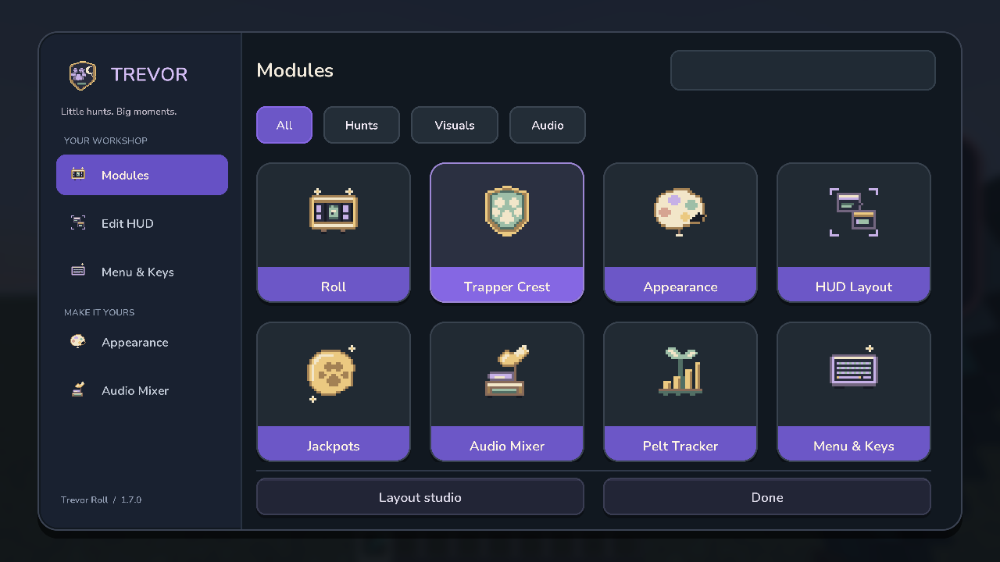
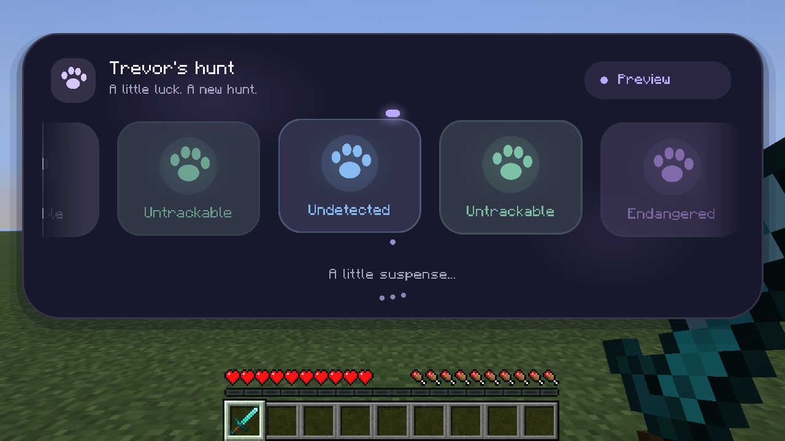
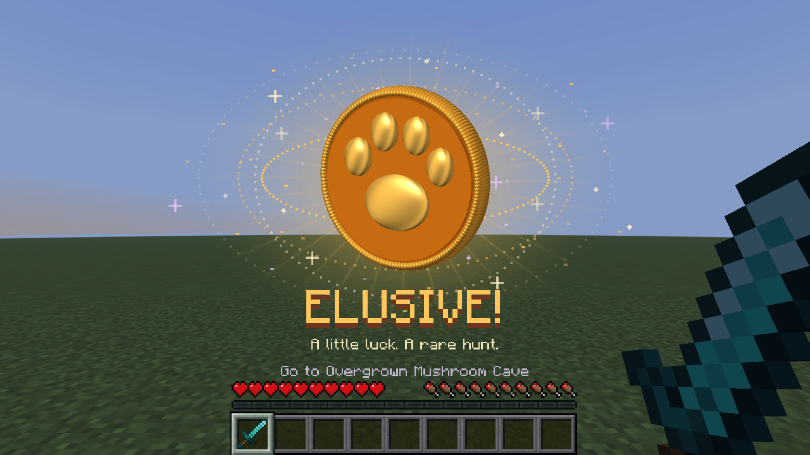
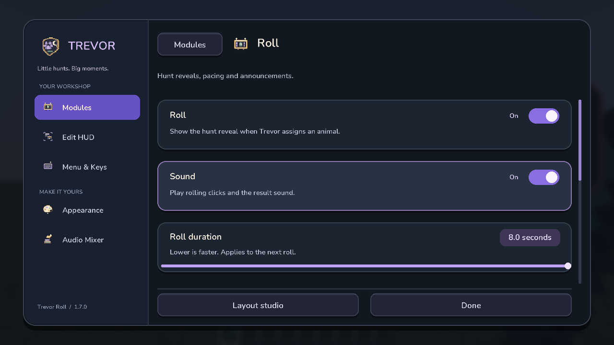
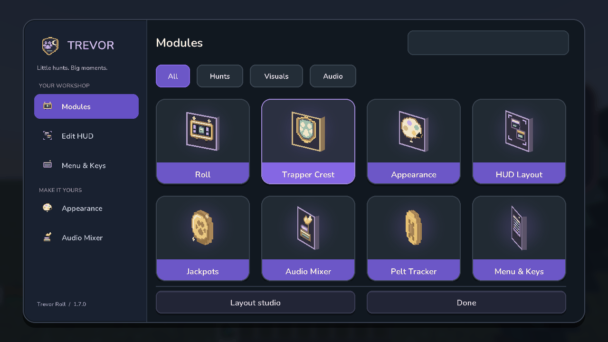
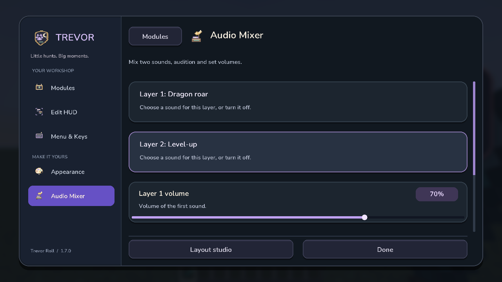
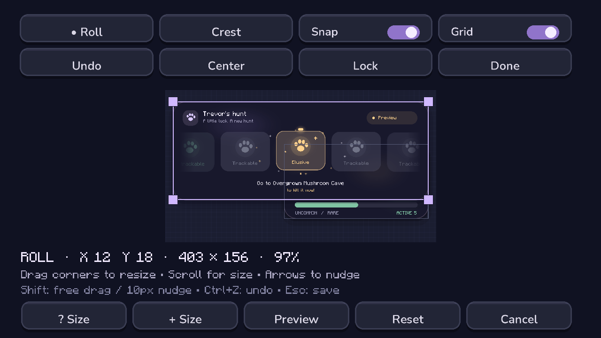
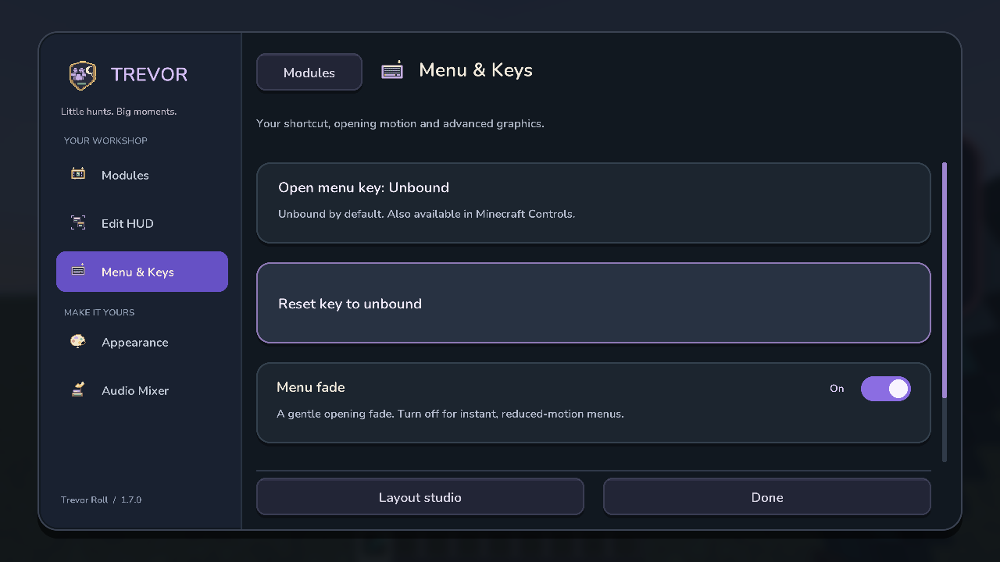

# Trevor Roll

A little more character for every Trevor hunt: animated reveals, golden Elusive celebrations and live Trapper Crest progress for **Hypixel SkyBlock**.

**[Download 1.7.0](https://github.com/SleepCodeX/trevorRngMod/releases/latest)** · **[Development builds](https://github.com/SleepCodeX/trevorRngMod/actions/workflows/build.yml)** · **`/trevormod settings`**

**Minecraft Java 26.2 · Fabric · Client-side**

## Little hunts. Big moments.

The reel reveals the rarity Trevor already assigned—it never changes your odds. Elusive hunts get their own celebration, with four styles and two sound layers you can mix yourself.

| Your next hunt | An Elusive moment |
| --- | --- |
|  |  |

Keep a **Trapper Crest in your hotbar**. The HUD follows the first crest from the left, reads its actual pelt lore, and reminds you when it is time to switch. Pelts/hour and optional completion sounds help you keep going.

## Make it yours

Eight modules keep your roll, crest, HUD layout, rewards, sound and menu preferences in one place. Search for what you need, open a card, and adjust it—without digging through commands.

The default menu stays lightweight. Turn on **Menu & Keys → Advanced graphics** for slowly rotating pixel artwork, a pelt coin and a thick crest plate. Labels stay still. Prefer instant menus? Switch **Menu fade** off.

Sound mixer, HUD editor and menu preferences

Pick two reward sounds and preview the mix.

Drag your HUD panels, resize their corners, and use snapping, locks or Undo to get the placement right. **Done** saves; **Cancel** restores the layout you started with.

The opening shortcut is **unbound by default**. Assign it in **Menu & Keys** or Minecraft's **Controls → Key Binds → Trevor Roll**. In the menu, **Escape** cancels key capture and **Delete / Backspace** clears the binding.

## Install & play

1. Use **Minecraft 26.2**, **Java 25**, **Fabric Loader 0.19.5+** and **Fabric API for 26.2**.
2. Put one Trevor Roll JAR in your instance's `mods` folder. Remove older copies.
3. Join Hypixel SkyBlock, talk to Trevor, and keep your crest in hotbar slots **1–9**.
4. Open **`/trevormod settings`** to make it feel like yours.

[Download the 1.7.0 JAR](https://github.com/SleepCodeX/trevorRngMod/releases/download/1.7.0/trevor-roll-1.7.0.jar). Prefer building it yourself? See the [developer guide](docs/DEVELOPMENT.md#build).

### Handy commands

- **`/trevormod settings`** — open every setting.
- **`/trevorroll test elusive`** — preview a complete Elusive reveal.
- **`/trevormod preview`** — preview your chosen celebration.
- **`/trevorcrest demo uncommon`** — preview crest progress; `rare` and `missing` work too.

Scroll or use **Tab**, **Page Up / Down**, and **Home / End** in the menu. Settings save when you leave. The optional menu shortcut works during gameplay without stealing chat input.

[All commands, requirements and building](docs/DEVELOPMENT.md) · [Validation](VALIDATION.md) · [MIT license](LICENSE)

*Images show real Minecraft demo sessions, not live Hypixel results. [Menu media](docs/media/1.7.0/README.md) · [Gameplay media](docs/media/1.6.0/README.md). Menu organization is inspired by [OneClient](https://polyfrost.org/projects/oneclient); Trevor's artwork is original, and OneClient is not required.*
