# Trevor Roll

Small hunts. Big moments. Your client-side Trevor companion for **Hypixel SkyBlock**.

**[Download 1.9.1](https://github.com/SleepCodeX/trevorRngMod/releases/latest)** · **Minecraft 26.2 · Fabric · Java 25**

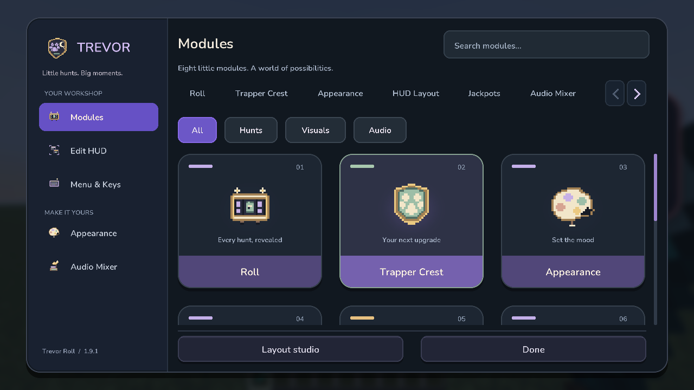

Open **`/trevormod settings`**.

## The hunt

| Rarity reveals | Trapper Crest |
| --- | --- |
| 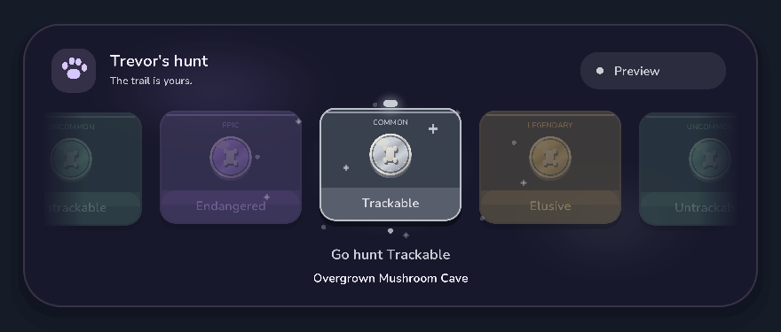 | 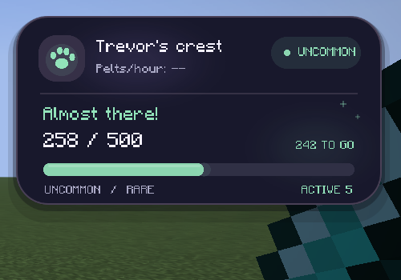 |
| Preview with **`/trevorroll test elusive`**. | Tracks the first crest from the left in hotbar slots **1–9**, using its item lore. |

## Extreme Elusive

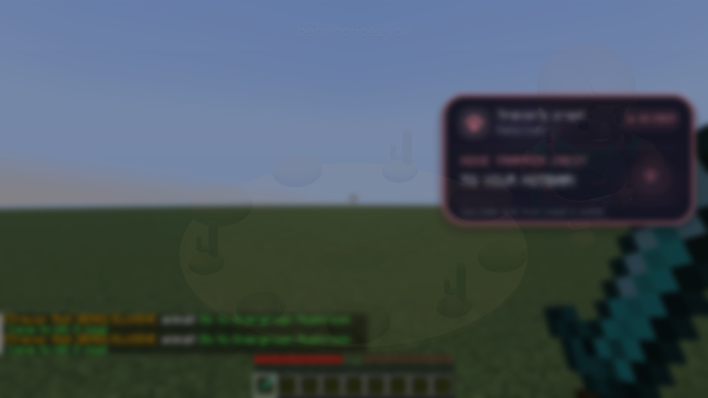

Select **Jackpots → Extreme**, then enable **Extreme 3D roll**. The intro plays **only for Elusive**, with its own duration control. The roar follows the dragon transition.

| Extra | Extreme |
| --- | --- |
| 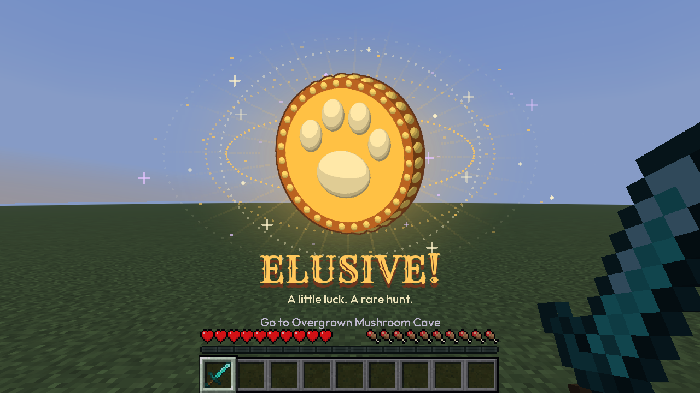 | 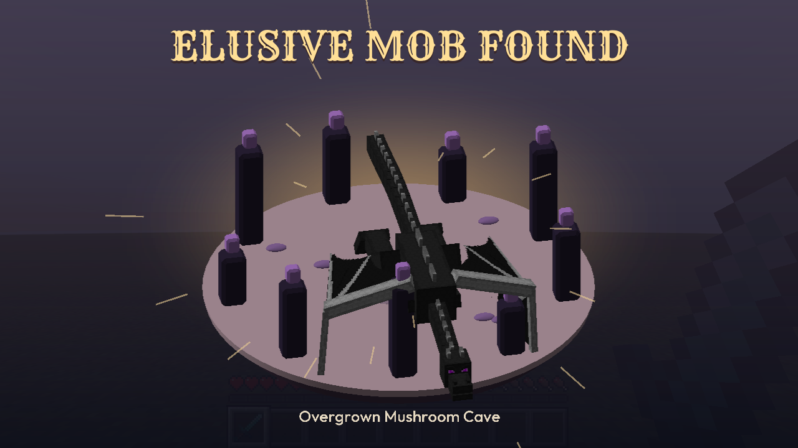 |

Minimal and Classic keep their lighter celebrations. **`/trevormod preview`** previews your selected reward.

## Your modules

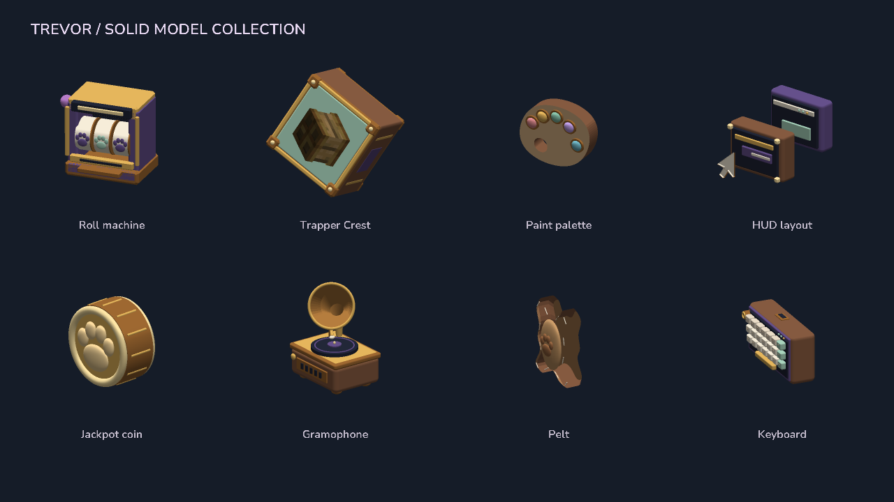

Enable **Menu & Keys → Advanced graphics**. Static 2D artwork is the default.

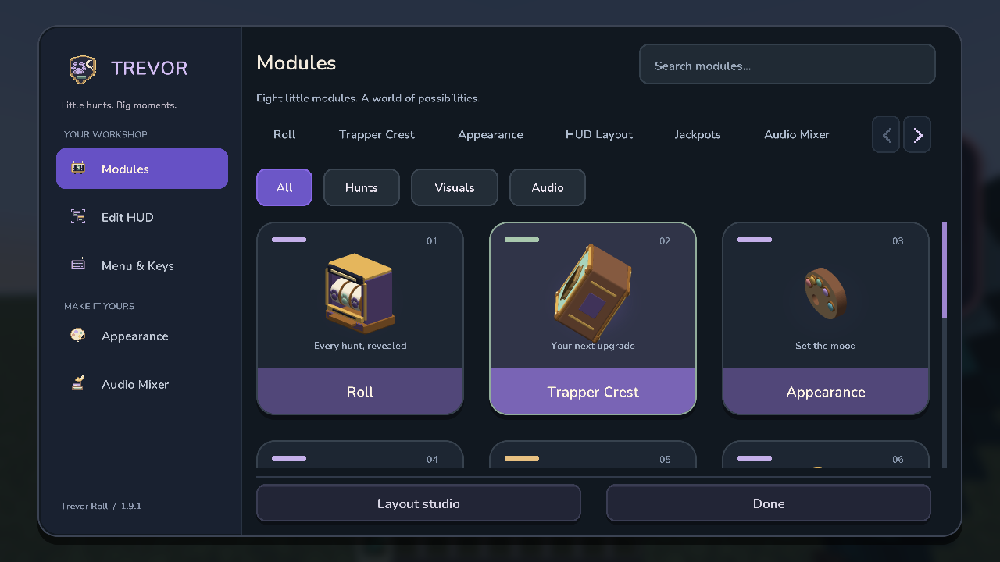

| Appearance | HUD layout |
| --- | --- |
| 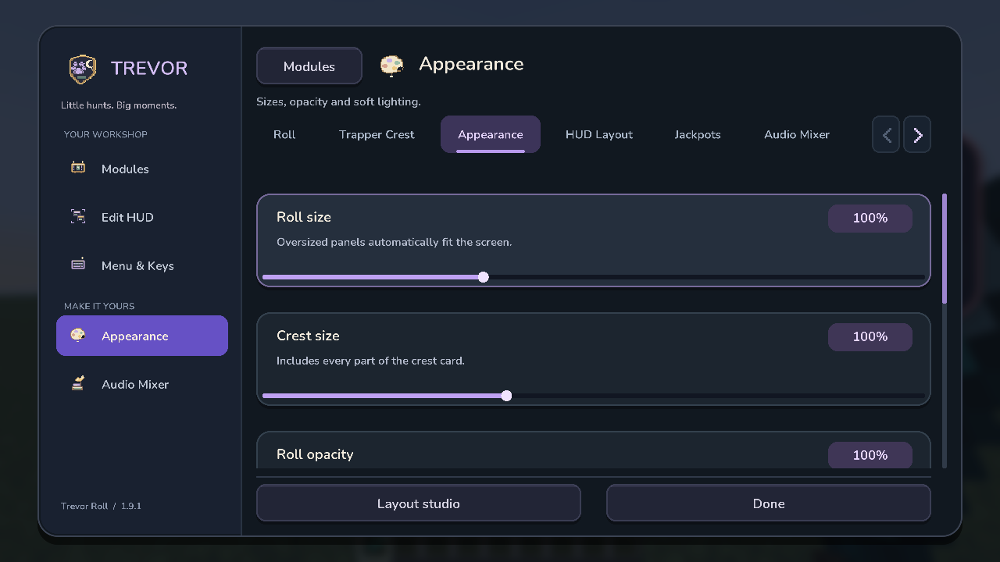 | 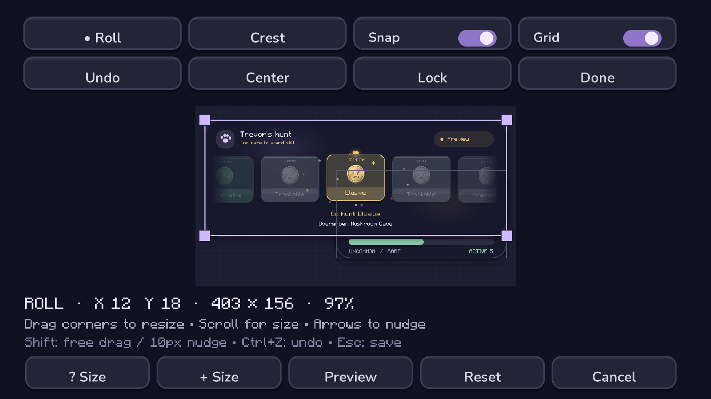 |

| Audio Mixer | Pelt Tracker |
| --- | --- |
| 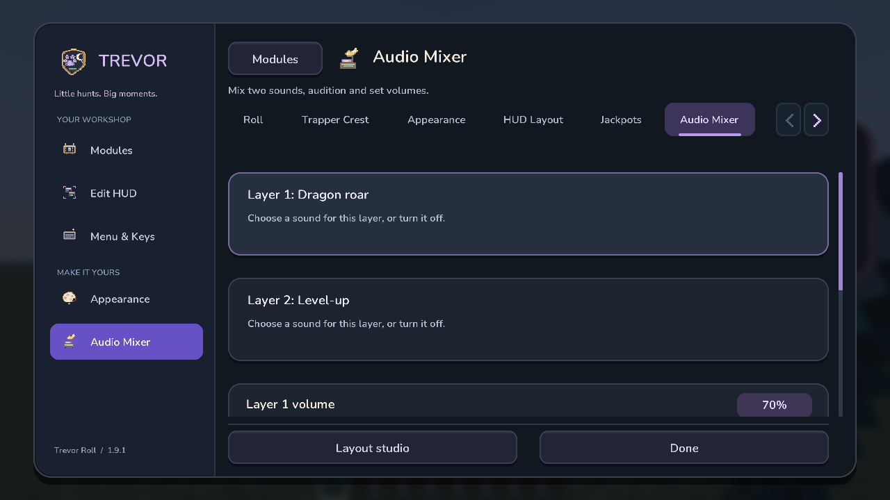 | 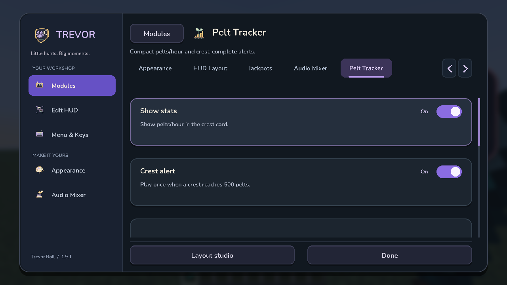 |

## Menu & keys

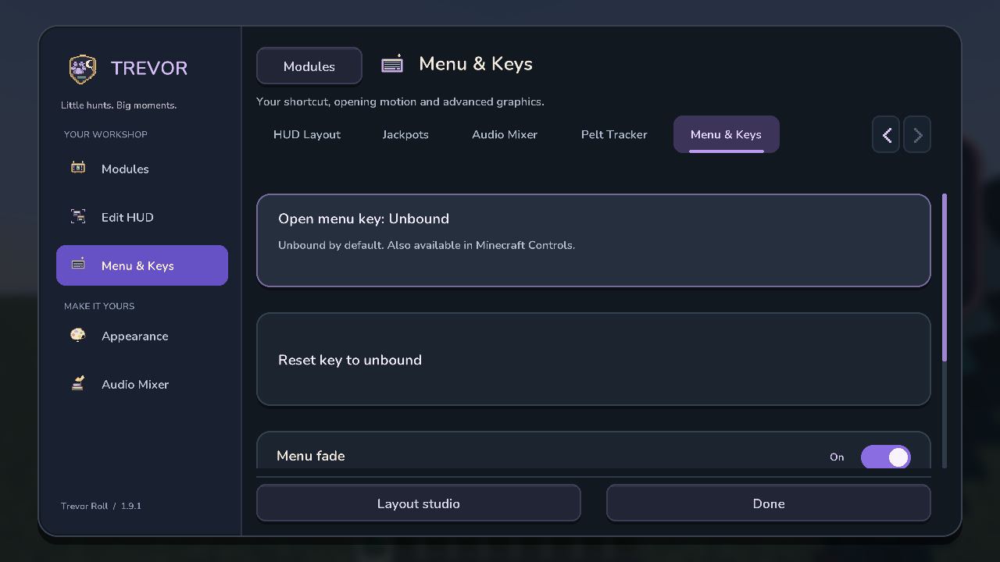

The shortcut starts **unbound**. Set it here or in **Minecraft Controls → Trevor Roll**. During capture, **Escape** cancels; **Delete / Backspace** clears.

## Install

1. Use **Minecraft 26.2**, **Java 25**, **Fabric Loader 0.19.5+** and **Fabric API for 26.2**.
2. Put [trevor-roll-1.9.1.jar](https://github.com/SleepCodeX/trevorRngMod/releases/download/1.9.1/trevor-roll-1.9.1.jar) in `mods`. Remove older Trevor Roll JARs.
3. Join Hypixel SkyBlock, talk to Trevor, and keep your crest in the hotbar.

[All commands & building](docs/DEVELOPMENT.md) · [Validation](VALIDATION.md) · [MIT license](LICENSE) · [Asset credits](docs/3D-MODELS.md#asset-credits)
