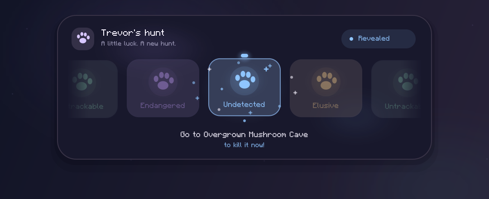

# Trevor Roll

A client-side Hypixel SkyBlock mod for **Minecraft 26.2**, built with **Fabric Loader 0.19.5**.

Accept Trevor's trapper task and get a short case-opening reveal: pastel paw cards scroll past a glowing selector, slow down, and land on the rarity Trevor actually assigned. The hunting location appears below the winning card and is saved in your local chat.



*Rendered UI preview using the mod's drawing code; not an in-game screenshot.*

## Requirements

| Component | Version |
| --- | --- |
| Minecraft Java Edition | 26.2 |
| Fabric Loader | 0.19.5 or newer; built against 0.19.5 |
| Fabric API | 0.161.0+26.2 or a newer compatible 26.2 build |
| Java / JDK for building | 25 |
| Mod version | 1.1.1 |

## Install

1. Build the project below, or download the compiled mod if the repository owner has published a release.
2. Put `trevor-roll-1.1.1.jar` in your Minecraft instance's `mods` folder alongside [Fabric API for 26.2](https://modrinth.com/mod/fabric-api/versions?g=26.2).
3. Remove any older Trevor Roll JAR so that only one version is installed.
4. Launch Minecraft 26.2 with Fabric Loader 0.19.5 and run `/trevorroll test undetected` in a world to preview it.

## Build

Install **JDK 25**, set `JAVA_HOME` to that JDK, and open a terminal in the folder containing `build.gradle`.

Windows PowerShell:

```powershell
.\gradlew.bat build
```

macOS / Linux:

```sh
bash gradlew build
```

The included Gradle wrapper downloads Gradle and the required dependencies on the first build. There is no need to install Gradle separately.

Build output:

```text
build/libs/trevor-roll-1.1.1.jar          # Install this in Minecraft
build/libs/trevor-roll-1.1.1-sources.jar  # Java source archive
```

For a development Minecraft instance, run `gradlew.bat runClient` on Windows or `bash gradlew runClient` on macOS/Linux.

## Commands

All commands run locally on the client.

| Command | Effect |
| --- | --- |
| `/trevorroll` | Show help |
| `/trevorroll test` | Preview a random rarity |
| `/trevorroll test elusive` | Preview a chosen rarity |
| `/trevorroll toggle` | Enable or disable the mod |
| `/trevorroll sound` | Toggle roll sounds |
| `/trevorroll duration 3` | Set the roll duration, from 1 to 8 seconds |
| `/trevorroll skip` | Reveal the pending hunt immediately |

Chosen preview rarities: `trackable`, `untrackable`, `undetected`, `endangered`, `elusive`.

Settings are saved in the instance's `config/trevor-roll.json`.

## Behavior

The mod matches Trevor's assignment format, for example:

```text
[NPC] Trevor: You can find your UNDETECTED animal near the Overgrown Mushroom Cave.
```

It temporarily hides that assignment from vanilla chat, plays the reveal, and displays:

```text
UNDETECTED
Go to Overgrown Mushroom Cave to kill it now!
```

- The winning rarity is always the original server assignment. Decorative reel cards do not affect the hunt.
- Live interception runs only for `hypixel.net` and its subdomains; preview commands also work in singleplayer.
- Unknown assignment formats and Trevor's failure/cooldown messages remain visible.
- Other mods may still read the original message or show their own hunt overlays.
- You can move during the reveal. The hunt timer continues running.
- Pressing F1 hides the panel with the normal HUD; the result still appears in chat after the roll.
- The result panel remains visible for 4.5 seconds after the roll ends.

## Source layout

```text
src/main/java/dev/trevorroll/
  Hunt.java                Assignment parser and rarity definitions
  Reel.java                Reel timing and the server-assigned winning card
  HudPainter.java          Shared UI layout and drawing logic
src/client/java/dev/trevorroll/
  TrevorRollClient.java     Fabric events, chat filtering, commands and sounds
  MinecraftCanvas.java      Minecraft GUI drawing adapter
  RollConfig.java           Local settings
src/main/resources/
  fabric.mod.json           Mod metadata and required versions
  assets/trevorroll/        Rounded-corner and glow textures
src/test/java/dev/trevorroll/
  LogicTest.java            Executable parser and reel checks
```

Versions are configured in `gradle.properties`. Mod compatibility requirements are declared in `src/main/resources/fabric.mod.json`.

## Validation

`build` runs the parser and reel checks: all five rarities, messages that must stay visible, the supplied assignment format, and landing/timing behavior over 500 seeded rolls. You can run these checks separately with `gradlew.bat logicTest` or `bash gradlew logicTest`.

Version 1.1.1 compiled successfully against Fabric Loader 0.19.5. The UI has been inspected using rendered previews at several sizes. Live Minecraft/Hypixel testing is still needed.

## Upload this project to GitHub

Create a repository, extract the source ZIP, and upload the **contents** of this project folder so `README.md`, `build.gradle`, `gradlew`, `gradle/`, and `src/` sit at the repository root. Keep `.gitignore` and `.gitattributes` included when committing with Git. The Gradle wrapper JAR must also be committed.

Generated `build/`, `.gradle/`, development `run/` files, and local IDE settings are excluded by `.gitignore`. Compiled mod JARs can be attached to a GitHub release separately.

## License

[MIT](LICENSE).
