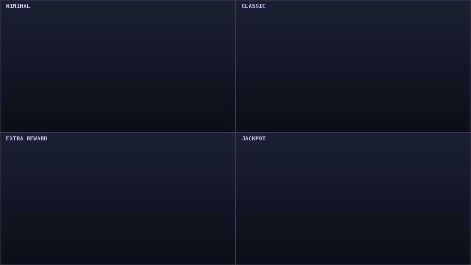
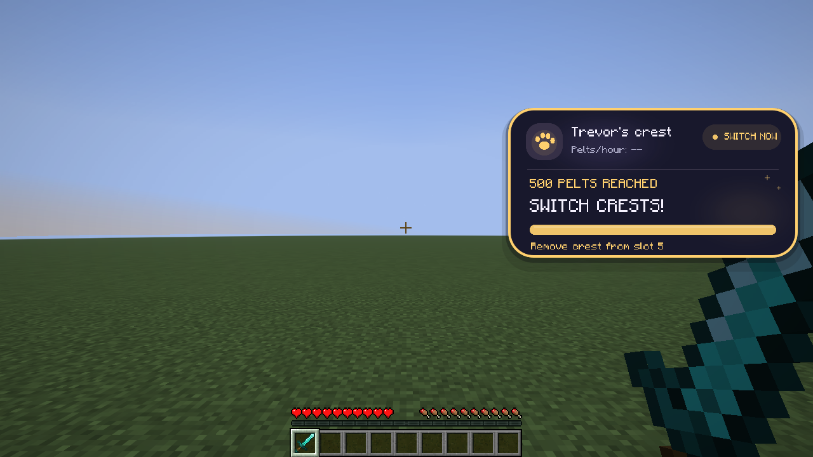
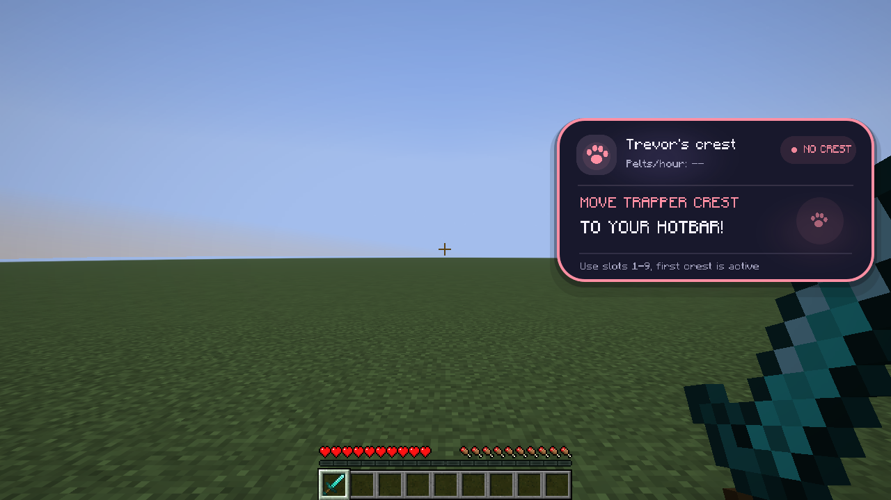
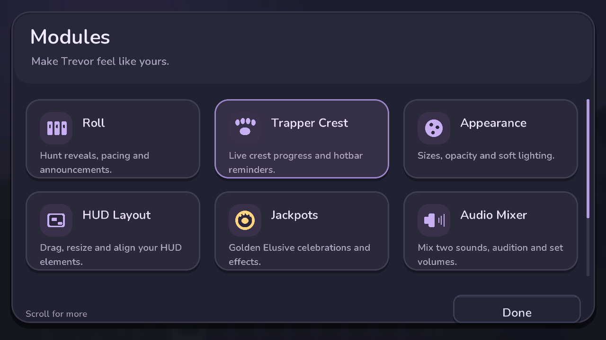
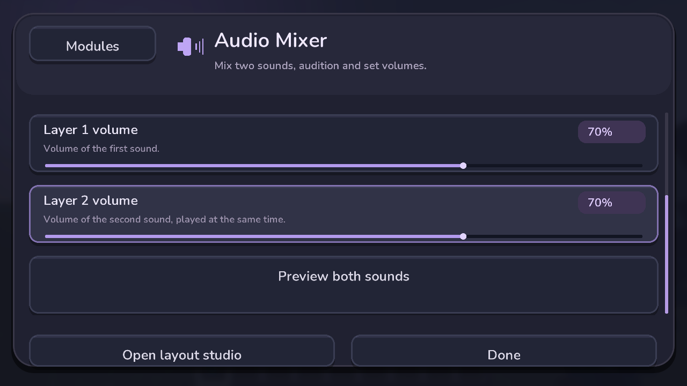

# Trevor Roll

Animated Trevor hunt reveals, golden Elusive celebrations, and a live Trapper Crest HUD for **Hypixel SkyBlock**.

**[Download the latest JAR](https://github.com/SleepCodeX/trevorRngMod/releases/latest)** · **Open settings: `/trevormod settings`**

## Get started

1. Install **Minecraft 26.2**, **Fabric Loader 0.19.5+**, and a compatible **Fabric API for 26.2**.
2. Put [trevor-roll-1.6.0.jar](https://github.com/SleepCodeX/trevorRngMod/releases/download/1.6.0/trevor-roll-1.6.0.jar) in your instance's `mods` folder. Remove older Trevor Roll JARs.
3. Join Hypixel SkyBlock and talk to Trevor. Your next supported hunt assignment starts the reveal automatically.
4. Put a **Trapper Crest in hotbar slots 1–9** to show its progress. The first crest from the left is the active one.
5. Run **`/trevormod settings`** to change timing, sounds, sizes and HUD positions.

The screenshots below show the mod in a local Minecraft test world with demo hunts and crest states. Live hunt detection runs on Hypixel; preview commands also work in singleplayer.

## Watch your hunt roll in

When Trevor assigns an animal, the rarity cards spin, slow down, and land on **the rarity Trevor already assigned**. The result shows where to go, and the assignment is repeated in chat after the reveal when chat results are enabled.


The roll is cosmetic: it does not change your hunt, odds or rewards. You can keep moving while it plays, and the hunt timer keeps running. Choose a **1–8 second roll**, change how long the result stays, or resize and move the panel.

**Try it:** `/trevorroll test undetected` previews a roll. `/trevorroll test elusive` previews the complete Elusive sequence.

## Make Elusive feel special

Only an **ELUSIVE** hunt triggers the extra celebration after the roll. A raised gold paw coin spins with rings, stars and confetti, depending on your selected style. The default audio plays **Dragon Roar + Level-up together**.


| Style | What you see |
| --- | --- |
| Minimal | A compact reward badge |
| Classic | A spinning gold paw coin and rings |
| Extra Reward (default) | More stars and celebratory effects |
| Jackpot | The most elaborate coin, rings and confetti celebration |

**Animated style comparison:**



[Open the Elusive animation GIF](docs/media/1.6.0/elusive-styles.gif). This silent comparison is rendered with the mod's actual HUD painter; the screenshot above is captured in Minecraft.

Use **Settings → Jackpots** to choose a style, duration and intensity. Use **Audio Mixer** to choose two sounds, adjust each volume, and preview the mix. Options include dragon roar, level-up, chime, fire, flowing water, droplets, lightning, thunder and more. Either layer can be switched off.

**Try it:** `/trevormod preview` plays your selected reward style in a world.

## Keep your Trapper Crests moving

The crest card reads the active item's **Collected pelts** lore and shows the progress bar, upgrade stage and hotbar slot. A crest in your Accessories Bag is not tracked; keep it in your hotbar.


- **Common:** progress toward 100 pelts.
- **Uncommon:** progress toward 500 pelts.
- **500 pelts / Rare:** a gold **SWITCH CRESTS!** reminder identifies which slot to replace.
- **No crest:** a pink reminder asks you to move a Trapper Crest to your hotbar.

| Time to switch | Missing-crest reminder |
| --- | --- |
|  |  |

The subtitle shows **pelts/hour only**. Tracking starts on your first real Trevor assignment or when a zero-pelt crest becomes active. The rate measures observed pelt gains, excluding existing progress and time with no crest or while offline. The screenshots use demo states, so the rate shows `--`; a running session first shows a short measuring period before its rate appears.

Use `/trevormod trackerStart` to start or reset a session, `/trevormod trackerStop` to stop, and `/trevormod trackerStats` to print the rate. In **Settings → Pelt Tracker**, choose a one-shot completion alert with up to two sounds when a crest reaches 500.

**Try it:** `/trevorcrest demo uncommon`, `/trevorcrest demo rare`, or `/trevorcrest demo missing`.

## Make the HUD yours

**`/trevormod settings`** opens seven modules with names, icons and descriptions:



| Module | What you can change |
| --- | --- |
| Roll | Enable the reveal, roll timing, result duration, sounds and chat results |
| Trapper Crest | HUD visibility, size, animations and missing-crest reminders |
| Appearance | Roll and crest size, opacity and glow |
| HUD Layout | Drag/resize editor, grid, snapping, locks and reset |
| Jackpots | Elusive style, duration, intensity and reward preview |
| Audio Mixer | Two Elusive sound layers, individual volumes and previews |
| Pelt Tracker | Pelts/hour visibility, session controls and completion sounds |

Scroll to reach more modules or settings. Your choices save when you leave the screen. Optional Mod Menu integration opens the same settings.

<details>
<summary>See the sound mixer and drag/resize editor</summary>



Open **HUD Layout → Open layout editor**, select Roll or Crest, then drag the panel or its corner handles. Scroll to fine-tune size, use arrow keys to nudge, or Shift-drag to bypass snapping. Grid, alignment guides, locks and Undo help keep the layout tidy. **Done** saves; **Cancel** restores the layout from when the editor opened.


</details>

## Requirements

| Component | Version |
| --- | --- |
| Minecraft Java Edition | 26.2 |
| Fabric Loader | 0.19.5 or newer; built against 0.19.5 |
| Fabric API | 0.161.0+26.2 or a newer compatible 26.2 build |
| Java / JDK for building | 25 |
| Mod version | 1.6.0 |

## Build

Install **JDK 25**, set `JAVA_HOME` to that JDK, and open a terminal in the folder containing `build.gradle`.

Windows PowerShell:

```powershell
.\gradlew.bat clean build check --no-daemon
```

macOS / Linux:

```sh
bash gradlew clean build check --no-daemon
```

The included Gradle wrapper downloads Gradle and the required dependencies on the first build. There is no need to install Gradle separately.

Build output:

```text
build/libs/trevor-roll-1.6.0.jar          # Install this in Minecraft
build/libs/trevor-roll-1.6.0-sources.jar  # Java source archive
```

For a development Minecraft instance, run `gradlew.bat runClient` on Windows or `bash gradlew runClient` on macOS/Linux.

Minecraft 26.2 uses unobfuscated names. The official `net.fabricmc.fabric-loom` plugin's `jar` task produces the production JAR; there is no `remapJar` task for this target. `check` verifies the actual JAR with `javap`, including both `FabricLoader` interface references and the absence of bundled runtime stubs. Run `gradlew.bat runProductionClientGameTest --no-daemon` (or `bash gradlew runProductionClientGameTest --no-daemon`) to launch the packaged mod in a disposable world and check commands, hotbar lore and HUD screenshots. The separate `-gametest.jar` is a test harness and must not be installed by users.

## Commands

All commands run locally on the client.

| Command | Effect |
| --- | --- |
| **`/trevormod settings`** | **Open the general settings menu: GUI editor, element positioning, and timing controls** |
| `/trevormod preview` | Preview the selected Elusive celebration |
| `/trevormod trackerStart` | Start or reset the pelts/hour session |
| `/trevormod trackerStop` | Stop tracking pelts/hour |
| `/trevormod trackerStats` | Print the current pelts/hour |
| `/trevorroll` | Show help |
| `/trevorroll test` | Preview a random rarity |
| `/trevorroll test elusive` | Preview a chosen rarity |
| `/trevorroll toggle` | Enable or disable the mod |
| `/trevorroll sound` | Toggle roll sounds |
| `/trevorroll duration 3` | Set the roll duration, from 1 to 8 seconds |
| `/trevorroll skip` | Reveal the pending hunt immediately |

Chosen preview rarities: `trackable`, `untrackable`, `undetected`, `endangered`, `elusive`.

Settings are saved in the instance's `config/trevor-roll.json`.

## Behavior

The mod matches Trevor's assignment format, for example:

```text
[NPC] Trevor: You can find your UNDETECTED animal near the Overgrown Mushroom Cave.
```

It temporarily hides that assignment from vanilla chat, plays the reveal, and displays:

```text
UNDETECTED
Go to Overgrown Mushroom Cave to kill it now!
```

- The winning rarity is always the original server assignment. Decorative reel cards do not affect the hunt.
- Live interception runs only for `hypixel.net` and its subdomains; preview commands also work in singleplayer.
- Unknown assignment formats and Trevor's failure/cooldown messages remain visible.
- Other mods may still read the original message or show their own hunt overlays.
- You can move during the reveal. The hunt timer continues running.
- Pressing F1 hides the panel with the normal HUD; the result still appears in chat after the roll.
- The result panel remains visible for 4.5 seconds after the roll ends.

## Trapper Crest HUD

Trevor Roll now includes a second Fabric client initializer, `dev.crestwatch.trapper.TrapperCrestHudClient`, inside **the same mod JAR**. Only one Trevor Roll JAR is needed. The HUD is client-only and doesn't send commands or modify player items.

It scans **hotbar slots 1–9**, not your whole inventory. A Trapper Crest can be anywhere in those slots, even when not currently selected. It reads the server-provided tooltip lore text (not a locally estimated running total): e.g. `Collected: 258 pelts`. A crest in your Accessories Bag does not count as being in your hotbar.

| Stage in hotbar | Display |
| --- | --- |
| No crest | Bold pink `MOVE TRAPPER CREST / TO YOUR HOTBAR!` reminder |
| Common crest (`x1.1`) | Live `Collected / 100 Pelts` and progress bar |
| Uncommon crest (`x1.25`) | `Almost there!` and live `Collected / 500 Pelts` progress bar |
| Active crest reaches 500 pelts, or has the Rare perk (`x1.5`) | Bold gold `500 PELTS REACHED / SWITCH CRESTS!`, with the slot to remove |
| Active crest leaves the hotbar | Track the next crest from the left within the next client tick, or show the missing-crest reminder. |

The HUD tracks the **first Trapper Crest from the left, scanning slots 1 through 9**. Other items are ignored. A completed crest farther right cannot override the crest currently gaining pelts. The panel labels the active slot; at 500 pelts it tells you which crest to remove. Detecting the stage from the lore's `x1.1`, `x1.25`, or `x1.5` perk also handles recombobulated crests without mistaking display rarity for upgrade stage. If no Pelt line is exposed by the server, the counter displays `--` instead of a fabricated zero.

When the item's lore includes an MP value, **3 MP = Common, 5 MP = Uncommon, 8 MP = Rare** is also recognized. Explicit perk and upgrade-progress text takes precedence over MP to handle recombobulated accessories. This reads per-item lore, never the player's total MP, and continues to use the actual pelt count for progress.

The HUD appears by default only on Hypixel, near the upper-right corner. It uses Trevor Roll's rounded shell, paw icon and soft textures. Completion and missing-crest states have a thicker colored border, stronger glow, larger action text, and a slow breathing highlight. The crest card yields during the original reel animation. Hotbar checks run once per client tick; unchanged item components reuse cached lore and state, so rendering does not repeatedly scan items or parse text. Warnings update on the next tick after a swap.


### Crest HUD commands

| Command | Effect |
| --- | --- |
| `/trevorcrest` | Show crest HUD help |
| `/trevorcrest toggle` | Show/hide only the crest HUD |
| `/trevorcrest demo common` | Preview Common state for 14 seconds |
| `/trevorcrest demo uncommon` | Preview Uncommon progress (258/500) |
| `/trevorcrest demo rare` | Preview Rare completion (504 collected) |
| `/trevorcrest demo missing` | Preview no-crest reminder |
| `/trevorcrest scale 1.15` | Change panel size (0.65 through 1.60) |
| `/trevorcrest top 120` | Move down (GUI pixels) |
| `/trevorcrest right 18` | Set distance from right edge |
| `/trevorcrest reset` | Restore positioning, sizing and visibility defaults |

Commands take effect immediately. The crest card temporarily yields while the original Trevor reveal is active, keeping its animation unobstructed at large GUI scales.

Or customize the auto-created `config/trapper-crest-hud.properties` file and restart Minecraft:

```properties
enabled=true
onlyHypixel=true
top=85
rightMargin=12
scale=1.0
```

**Common and Uncommon upgrade thresholds** match the provided October 2026 screenshots: Common to Uncommon at **100** Pelt progress, and Uncommon to Rare at **500**. This HUD tracks each individual crest's accumulated Pelts, not your purse or total player lifetime Pelts.

## Source layout

```text
src/main/java/dev/trevorroll/
  Hunt.java                Assignment parser and rarity definitions
  Reel.java                Reel timing and the server-assigned winning card
  HudPainter.java          Shared UI layout and drawing logic
src/client/java/dev/trevorroll/
  TrevorRollClient.java     Fabric events, chat filtering, commands and sounds
  MinecraftCanvas.java      Minecraft GUI drawing adapter
  RollConfig.java           Local settings
src/main/java/dev/crestwatch/trapper/
  CrestLoreParser.java     Reads Pelt totals and upgrade stage from item lore
  CrestHudState.java       Derives missing/common/uncommon/rare HUD state
  CrestHudFrame.java       Animation frame data (pure Java)
  CrestHudAnimator.java    Progress easing + short spring on stage changes
  CrestHudPainter.java     Floating bubble card layout, testable offline
src/client/java/dev/crestwatch/trapper/
  TrapperCrestHudClient.java  Hotbar scan, commands, renderer registration
  CrestHudCanvas.java      Adapter using Trevor Roll's circle + glow textures
  CrestHudConfig.java      HUD preferences
src/test/java/dev/crestwatch/trapper/
  CrestHudStateTest.java   Validates screenshot lore and state changes
  CrestHudAnimationTest.java  Visual layout and easing checks
src/main/resources/
  fabric.mod.json           Mod metadata and required versions
  assets/trevorroll/        Rounded-corner and glow textures
src/test/java/dev/trevorroll/
  LogicTest.java            Executable parser and reel checks
```

Versions are configured in `gradle.properties`. Mod compatibility requirements are declared in `src/main/resources/fabric.mod.json`.

## Validation

`build` runs the Trevor parser/reel tests, the Trapper Crest parsing/state tests, and the layout/animation checks (including the screenshot lore and Rare crest removal). The Trevor checks: all five rarities, messages that must stay visible, the supplied assignment format, and landing/timing behavior over 500 seeded rolls. You can run these checks separately with `gradlew.bat logicTest` or `bash gradlew logicTest`.

All runtime classes in 1.6.0 are compiled from source by Fabric Loom against the official dependencies. No classes are reused from the broken 1.3.0 binary. See [VALIDATION.md](VALIDATION.md) for build, bytecode and real-client test evidence and the user-confirmed in-game validation of earlier releases. GitHub Actions repeats the build and production-client tests and uploads only the installable mod JAR as the release artifact, with reports and screenshots in a separate evidence artifact.

## Upload this project to GitHub

Create a repository, extract the source ZIP, and upload the **contents** of this project folder so `README.md`, `build.gradle`, `gradlew`, `gradle/`, and `src/` sit at the repository root. Keep `.gitignore` and `.gitattributes` included when committing with Git. The Gradle wrapper JAR must also be committed.

Generated `build/`, `.gradle/`, development `run/` files, and local IDE settings are excluded by `.gitignore`. Compiled mod JARs can be attached to a GitHub release separately.

## License

[MIT](LICENSE).
