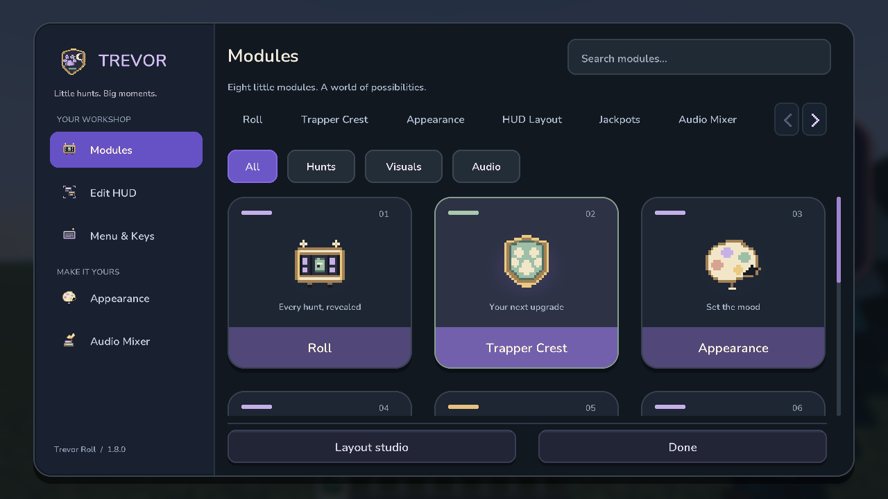
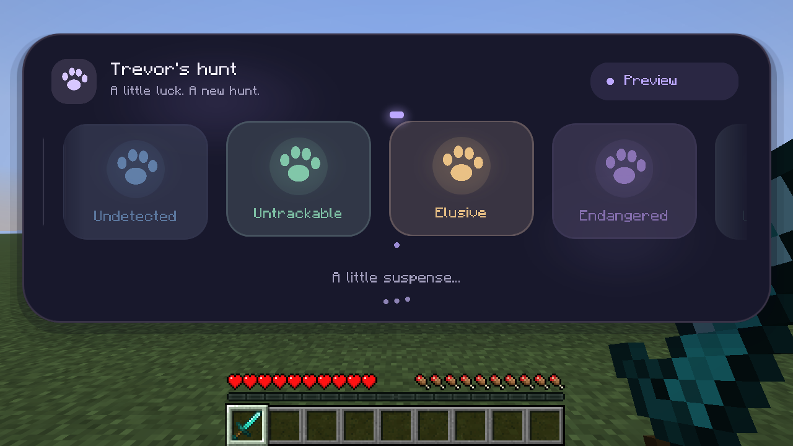
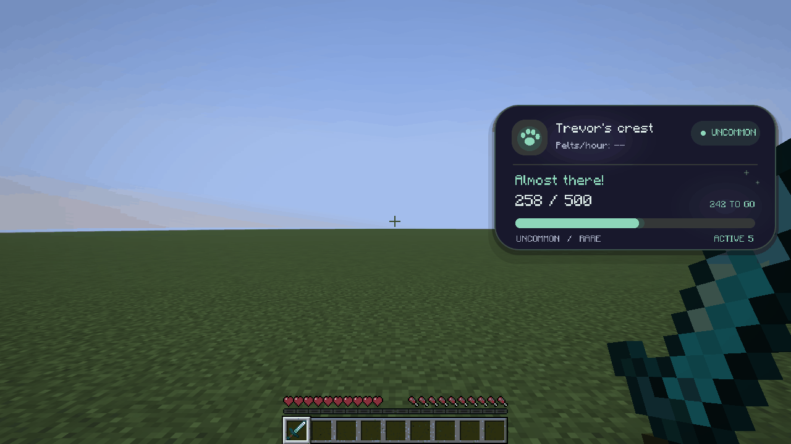
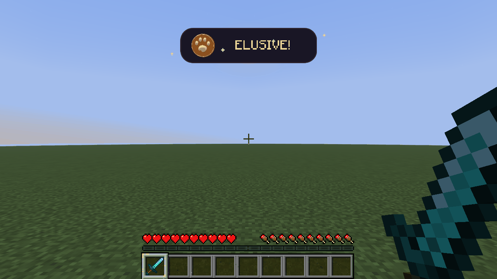
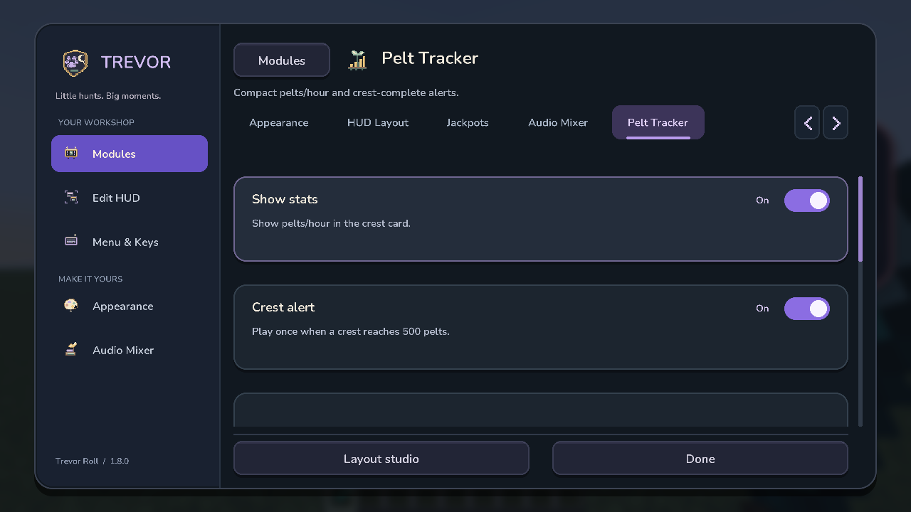
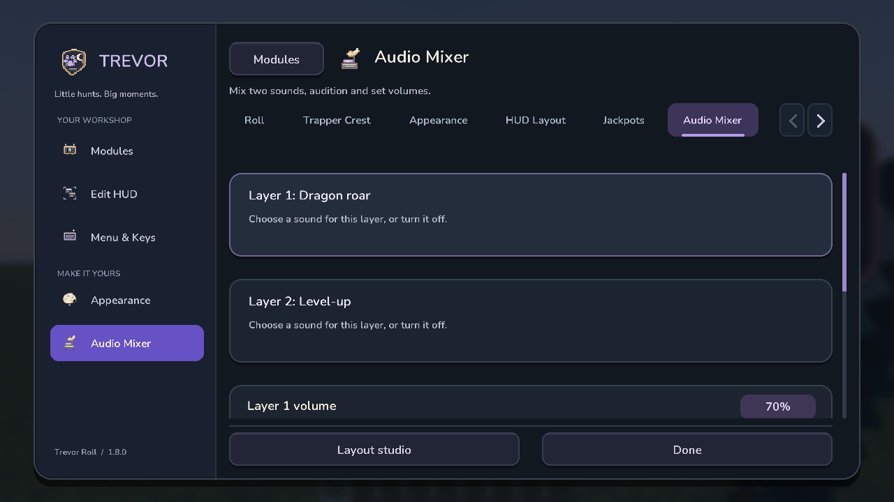
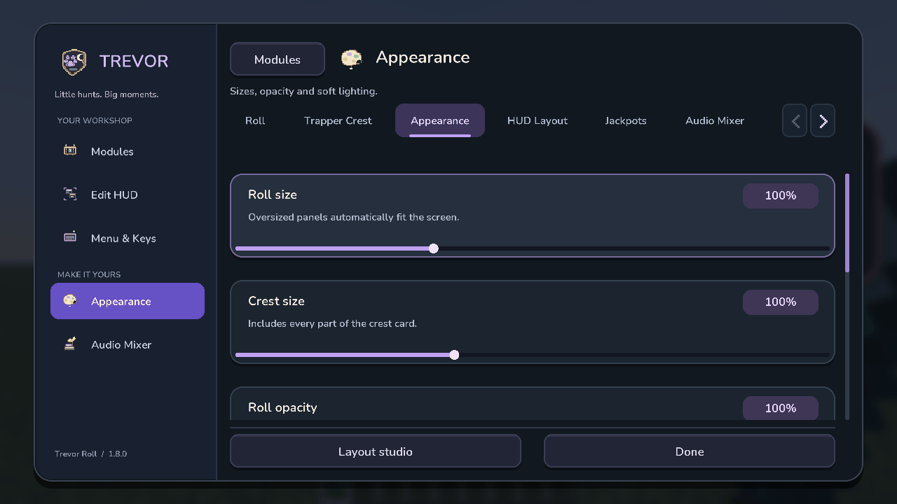
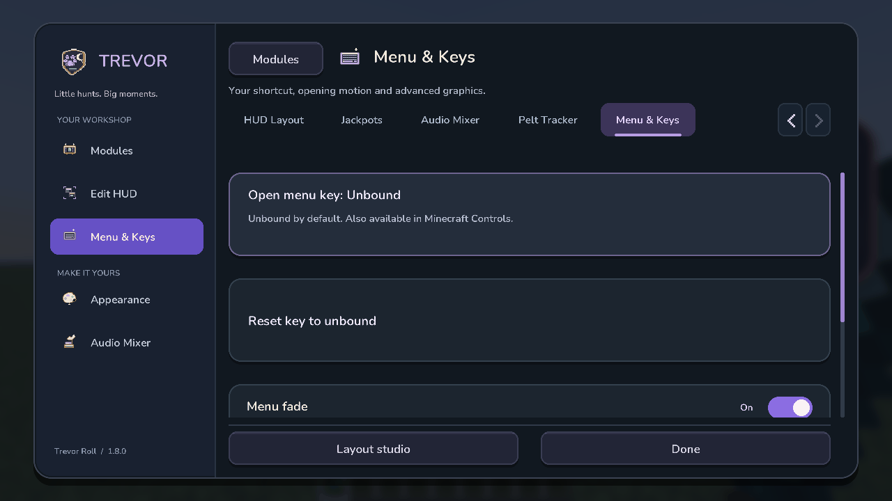
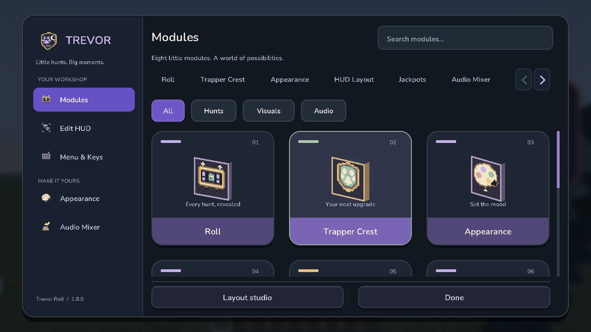

# Trevor Roll

Small hunts. Big moments. A client-side Trevor companion for **Hypixel SkyBlock**.

**[Download 1.8.0](https://github.com/SleepCodeX/trevorRngMod/releases/latest)** · **Minecraft 26.2 · Fabric · Java 25**

**Your hunt. Your way.** Roomy cards, quick module tabs, search and smooth scrolling. Open **`/trevormod settings`**.

| Hunt reveals | Trapper Crest |
| --- | --- |
| A little suspense for the rarity Trevor already chose. | The first crest from the left, tracked from its actual item lore. |
|  |  |

| Elusive celebrations | Pelt tracker |
| --- | --- |
| Four golden celebrations for the rare ones. | Pelts/hour and optional crest-completion sounds. |
|  |  |

| Sound, your way | A place for everything |
| --- | --- |
| Mix two sound layers and preview them together. | Drag, resize, snap and lock your HUD. |
|  |  |

| Set the mood | Open it your way |
| --- | --- |
| Tune sizes, opacity and glow. | Bind a shortcut or choose instant, reduced-motion menus. |
|  |  |

Set the menu shortcut in **Menu & Keys** or **Minecraft Controls → Trevor Roll**. During capture, **Escape** cancels and **Delete / Backspace** clears.

**A little extra depth.** Optional slowly turning artwork. Smooth fades in and out. Lightweight graphics stay the default; the shortcut starts **unbound**.

## Install & hunt

1. Use **Minecraft 26.2**, **Java 25**, **Fabric Loader 0.19.5+** and **Fabric API for 26.2**.
2. Put [trevor-roll-1.8.0.jar](https://github.com/SleepCodeX/trevorRngMod/releases/download/1.8.0/trevor-roll-1.8.0.jar) in `mods`. Remove older Trevor Roll JARs.
3. Join Hypixel SkyBlock, talk to Trevor, and keep your crest in hotbar slots **1–9**.

**`/trevormod settings`** opens everything. **`/trevorroll test elusive`** previews a hunt; **`/trevormod preview`** previews your reward.

[All commands & building](docs/DEVELOPMENT.md) · [Validation](VALIDATION.md) · [MIT license](LICENSE)

*Actual offline Minecraft demo captures, not live Hypixel results. [Media provenance](docs/media/1.8.0/README.md). Inspired by [OneClient](https://polyfrost.org/projects/oneclient); original Trevor artwork, no OneClient dependency. The mod never changes hunt odds.*
