# Trevor Roll

Small hunts. Big moments. Your client-side Trevor companion for **Hypixel SkyBlock**.

**[Download 1.9.1](https://github.com/SleepCodeX/trevorRngMod/releases/latest)** · **Minecraft 26.2 · Fabric · Java 25**

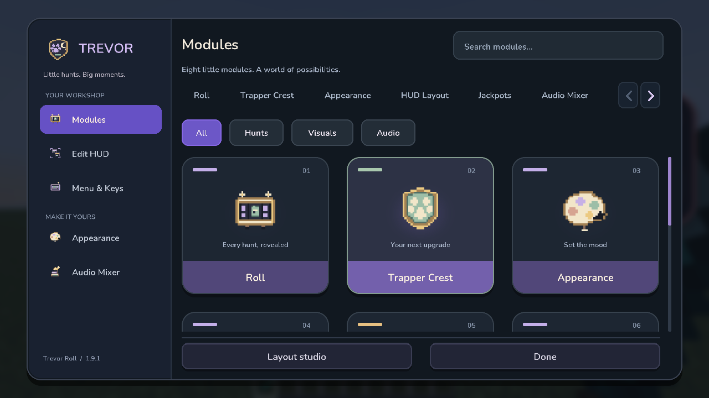

**Your hunt. Your way.** Eight modules, roomy cards, quick tabs, search and smooth scrolling. Open **`/trevormod settings`**.

| Every rarity has its moment | Your next crest upgrade |
| --- | --- |
| Gray Trackable, purple Endangered, golden Elusive. | Tracks the first crest from the left in hotbar slots **1–9**, using its item lore. |
| 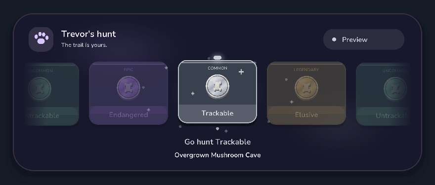 | 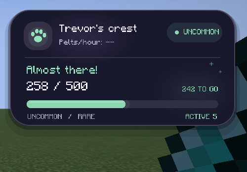 |

**Go Extreme.** A cowboy hunter tips his hat. The Ender Dragon closes in, with **ELUSIVE** above it through the final reveal.

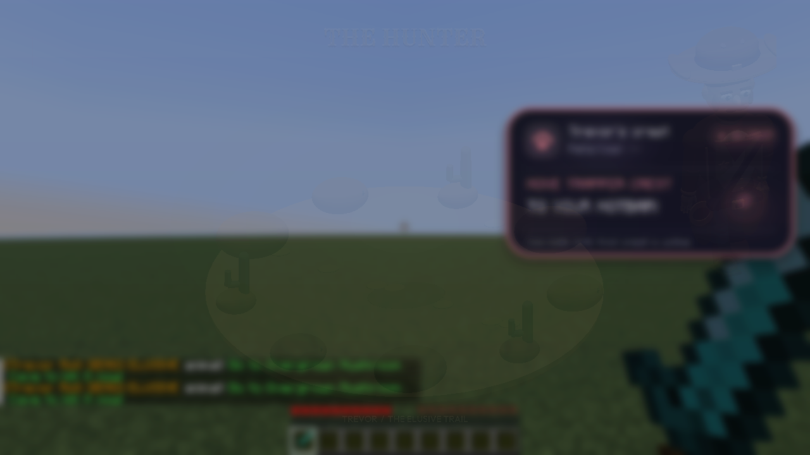

Choose **Jackpots → Style: Extreme** and enable **Extreme 3D roll**. The sequence plays **only for Elusive** and has its own duration control. **Extra** keeps the large spinning coin; Extreme stays on the dragon.

**Made to turn.** A complete roll machine, a paint palette with an open thumb hole, a thick tilted crest—and five more solid models.

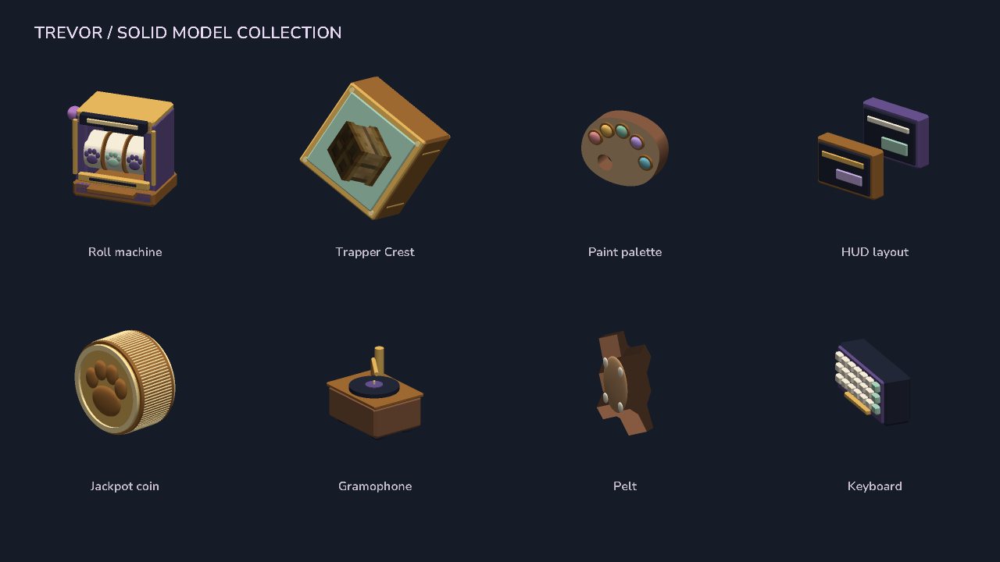

Enable **Menu & Keys → Advanced graphics** for the lit, spinning models. Static 2D art stays the default. Labels and controls stay still.

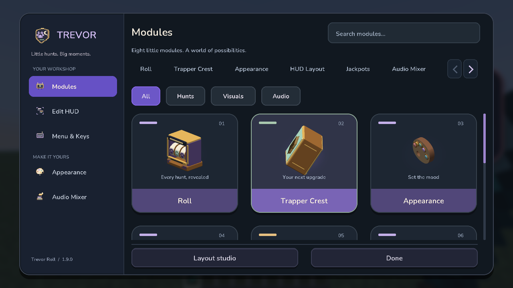

| Celebrate your way | Keep the pelts coming |
| --- | --- |
| Four styles, with new Western titles and clean captions. | Pelts/hour and optional crest-completion sounds. |
| 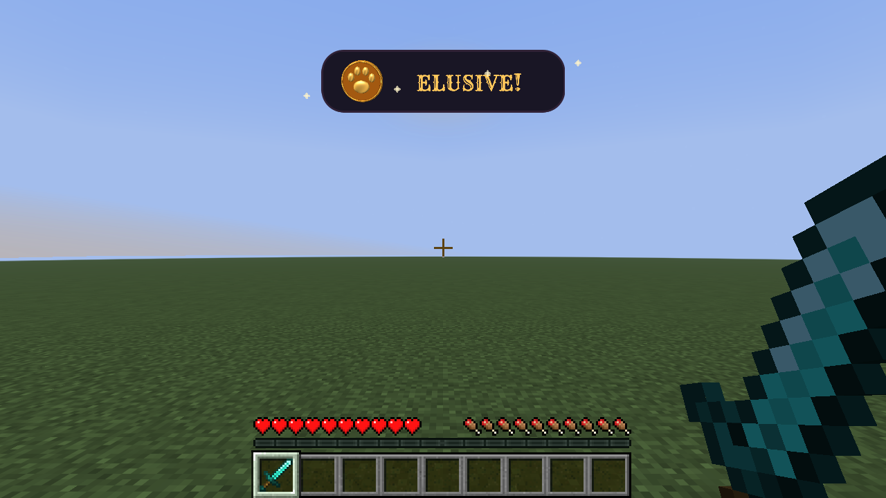 | 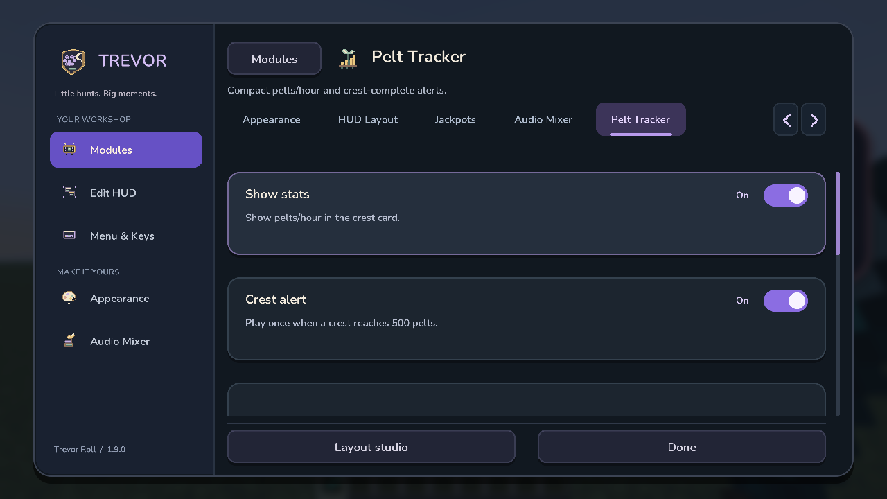 |

| Sound, your way | A place for everything |
| --- | --- |
| Mix two sound layers and preview them together. | Drag, resize, snap and lock your HUD. |
| 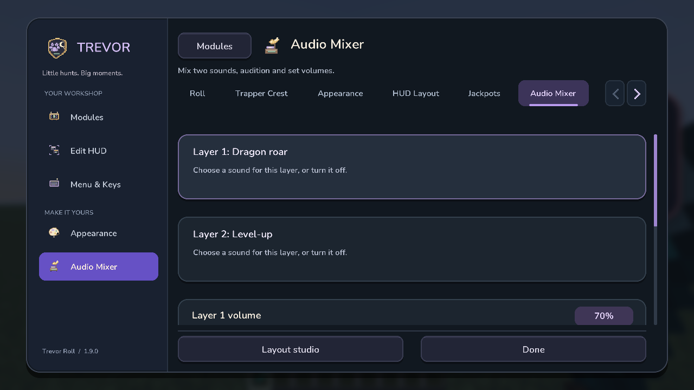 | 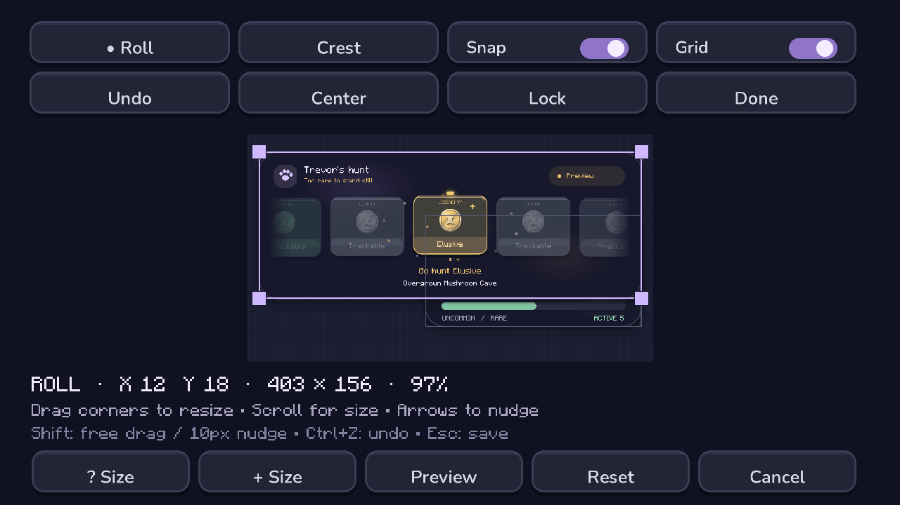 |

| Set the mood | Open it your way |
| --- | --- |
| Tune sizes, opacity and glow. | Smooth opening/closing fades, or instant reduced motion. |
| 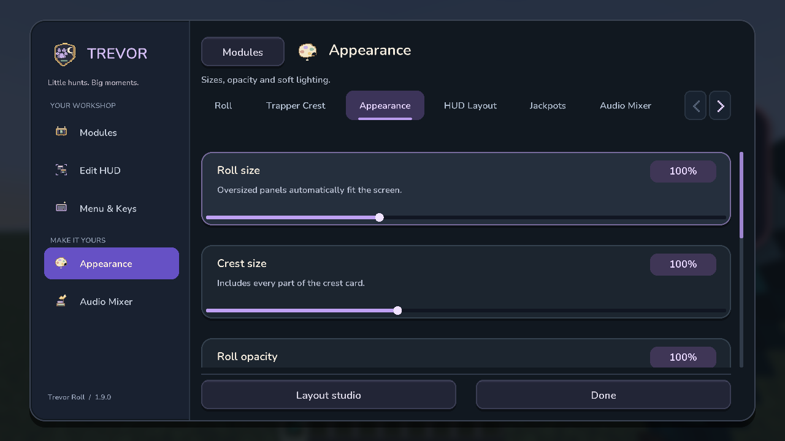 | 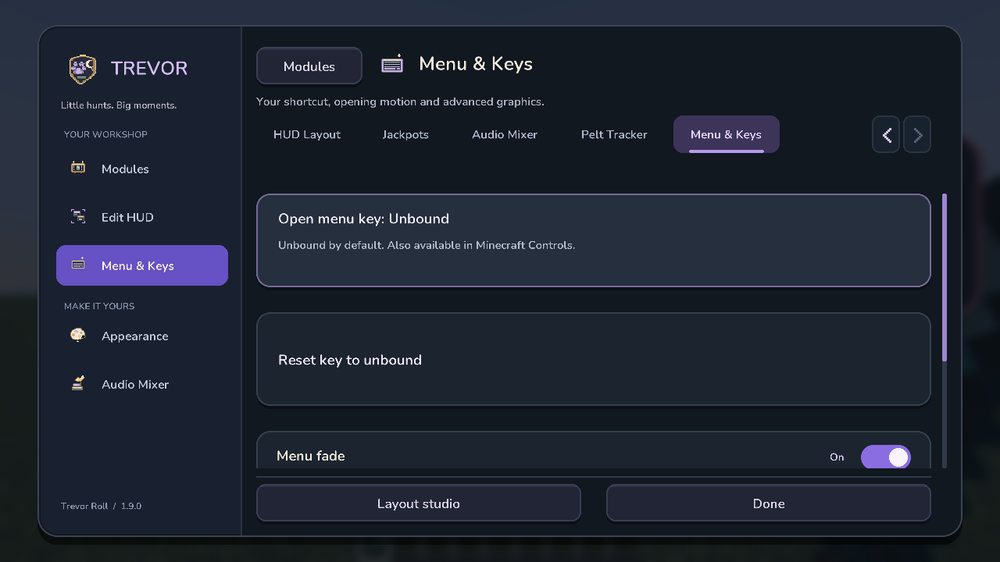 |

The shortcut starts **unbound**. Set it in **Menu & Keys** or **Minecraft Controls → Trevor Roll**. During capture, **Escape** cancels; **Delete / Backspace** clears.

## Install & hunt

1. Use **Minecraft 26.2**, **Java 25**, **Fabric Loader 0.19.5+** and **Fabric API for 26.2**.
2. Put [trevor-roll-1.9.1.jar](https://github.com/SleepCodeX/trevorRngMod/releases/download/1.9.1/trevor-roll-1.9.1.jar) in `mods`. Remove older Trevor Roll JARs.
3. Join Hypixel SkyBlock, talk to Trevor, and keep your crest in the hotbar.

**`/trevormod settings`** opens everything. **`/trevorroll test elusive`** previews a hunt with your selected style; **`/trevormod preview`** previews its reward.

[All commands & building](docs/DEVELOPMENT.md) · [Validation](VALIDATION.md) · [MIT license](LICENSE)
