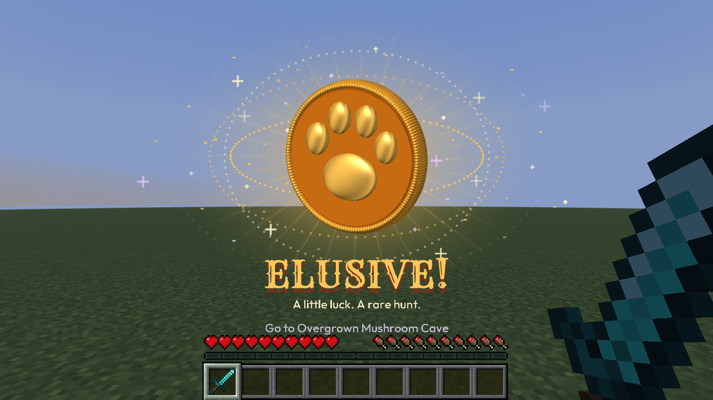
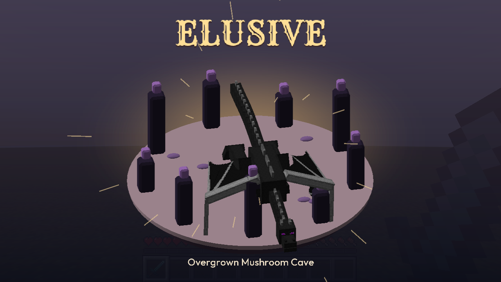

# Trevor Roll 1.9.1

A cowboy greeting. A dragon reveal.

**Extreme, refined.** A sculpted hunter tips his hat, then the Ender Dragon approaches with **ELUSIVE** above it. Western titles and clean captions complete the look. The dragon stays through the reward and fades out smoothly.

| Extra | Extreme |
| --- | --- |
| The large spinning golden coin. | The dragon reveal, with no coin afterward. |
|  |  |

Select **Jackpots → Style: Extreme** and enable **Extreme 3D roll** for the full hunter intro. It runs only for Elusive hunts. Extra keeps the coin; Minimal and Classic keep their lighter celebrations.

Three-column cards, top tabs, smooth fades, standalone 3D module models, rarity-colored hunt reveals, crest tracking, two-layer audio and HUD editing remain available. The shortcut starts unbound.

**Install:** Minecraft 26.2, Java 25, Fabric Loader 0.19.5+ and Fabric API for 26.2. Replace your older Trevor Roll JAR with `trevor-roll-1.9.1.jar`. Open **`/trevormod settings`**.
