# Trevor Roll 1.9.0

Your Trevor companion, with solid 3D models, a new rarity reel and an Extreme Elusive journey.

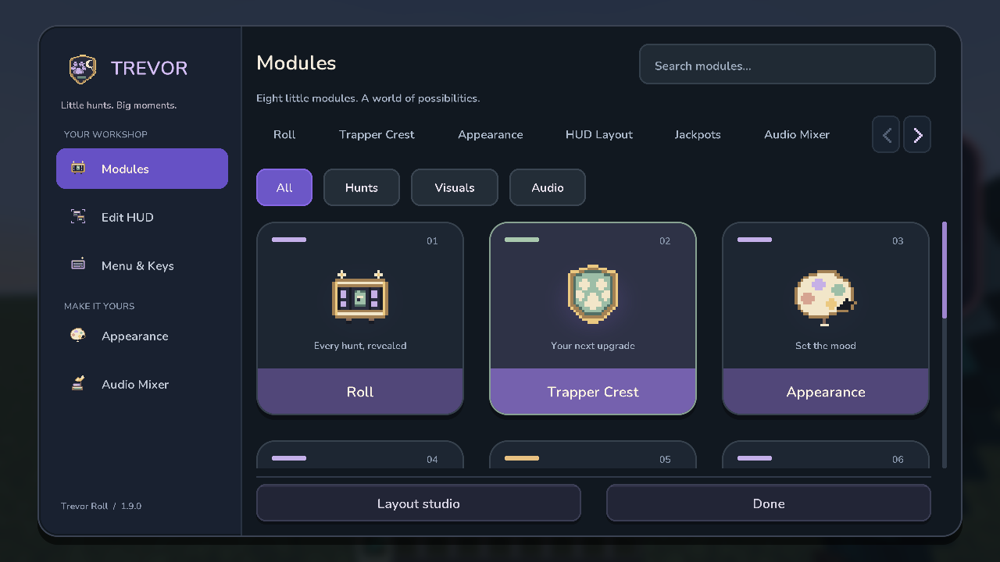

**Made to turn.** Eight complete 3D objects, including the roll machine, open-hole paint palette and thick angled Trapper Crest. Enable **Menu & Keys → Advanced graphics**; lightweight 2D art stays the default.

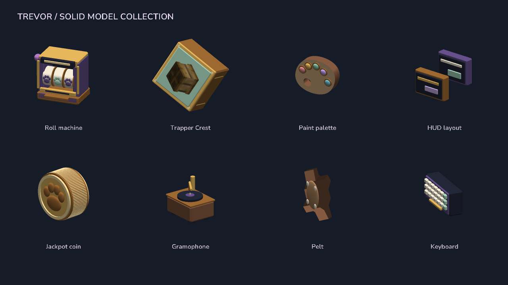

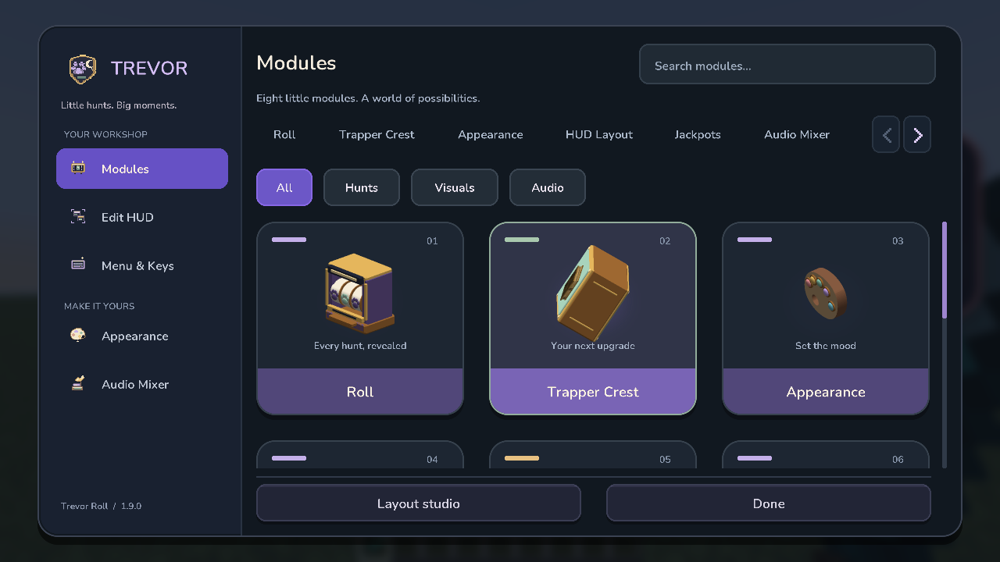

**Only for the elusive.** Trevor's wave, a sprinting rabbit, changing terrain and lighting, an approaching Ender Dragon, then gold.

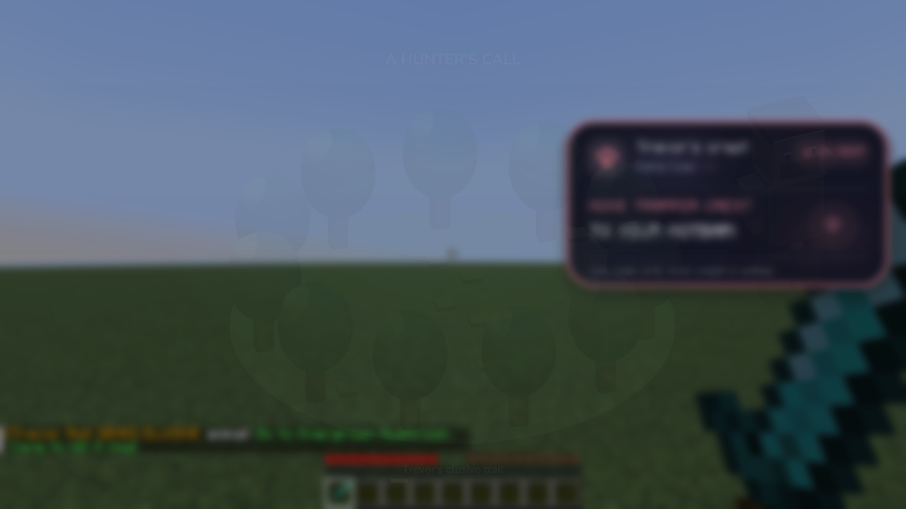

Select **Jackpots → Style: Extreme → Extreme 3D roll**. Minimal, Classic and Extra keep the regular reel. The cinematic has its own duration control.

**Every rarity, refined.** HD pelt coins, rarity-colored cards, cleaner outlines and rounded typography. Coins use a baked atlas; two gradient draws replace the reel's stepped edge masks.

| Hunt reveals | Trapper Crest |
| --- | --- |
| 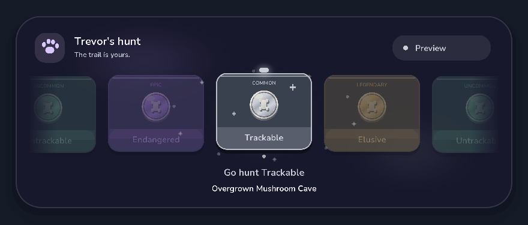 | 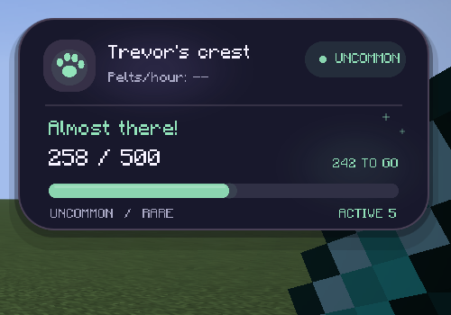 |

| Four reward styles | Pelt tracker |
| --- | --- |
| 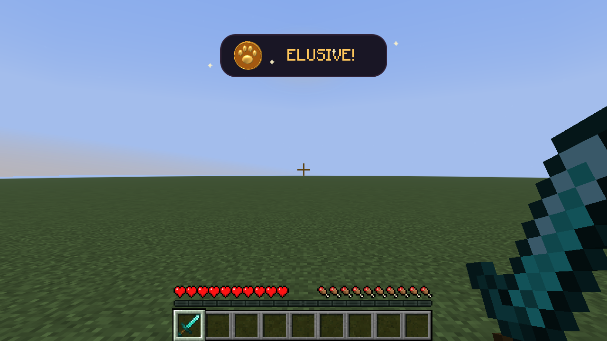 | 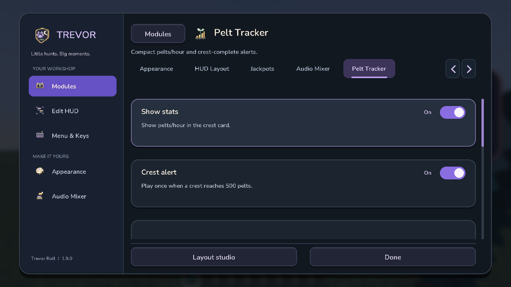 |

| Two-layer audio | HUD layout |
| --- | --- |
| 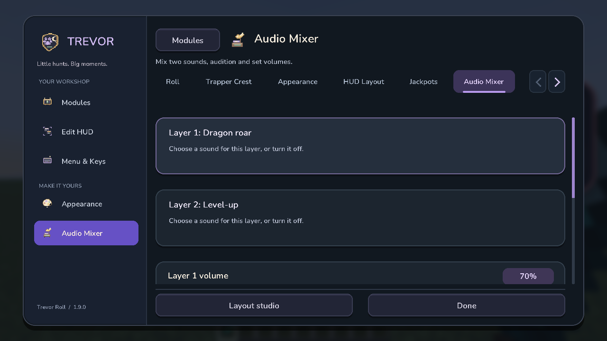 | 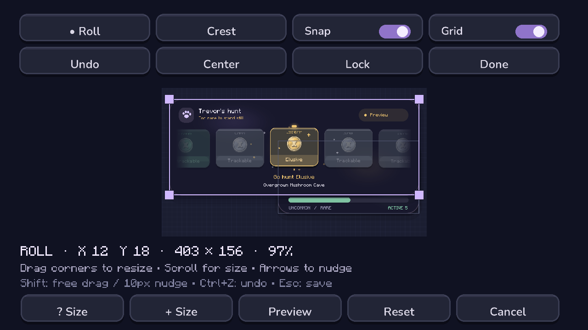 |

| Appearance | Menu & Keys |
| --- | --- |
| 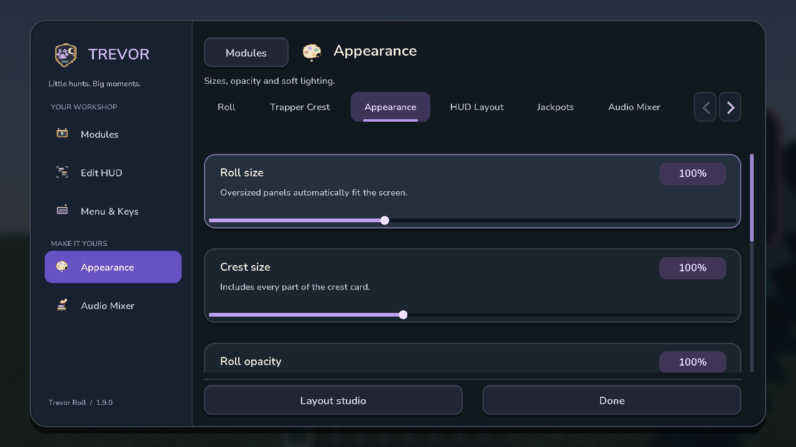 | 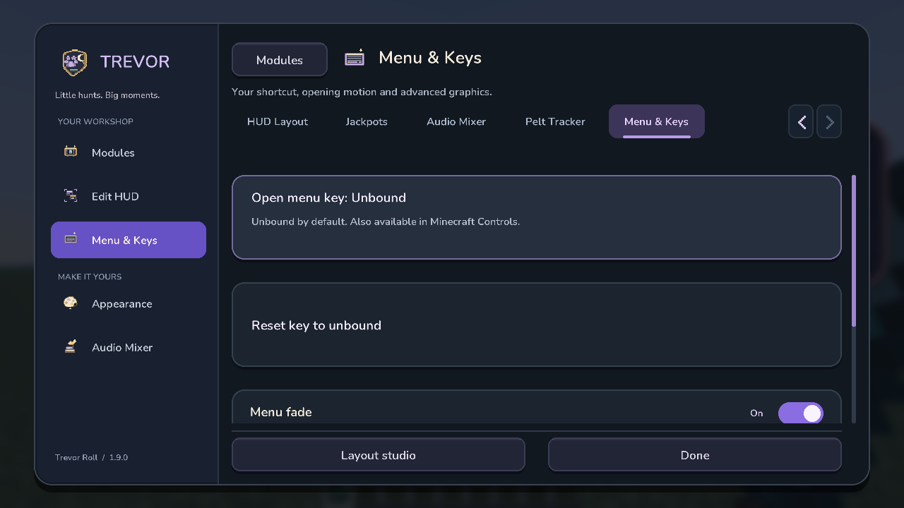 |

Three-column cards, top tabs, search, smooth scrolling and opening/closing fades remain. Reduced motion is one toggle away. The menu shortcut starts **unbound**; set it inline or in Minecraft Controls. Existing commands, hunt detection, crest tracking, HUD editing and audio layers are preserved.

**Install:** Minecraft 26.2, Java 25, Fabric Loader 0.19.5+ and Fabric API for 26.2. Replace your older Trevor Roll JAR with `trevor-roll-1.9.0.jar`. Open **`/trevormod settings`**.
