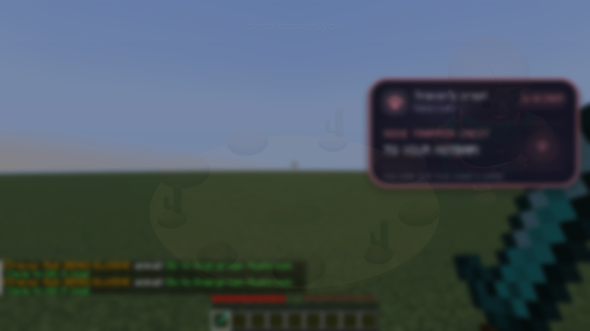
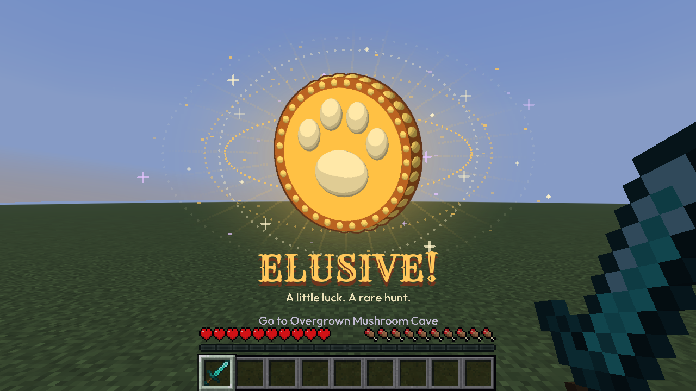
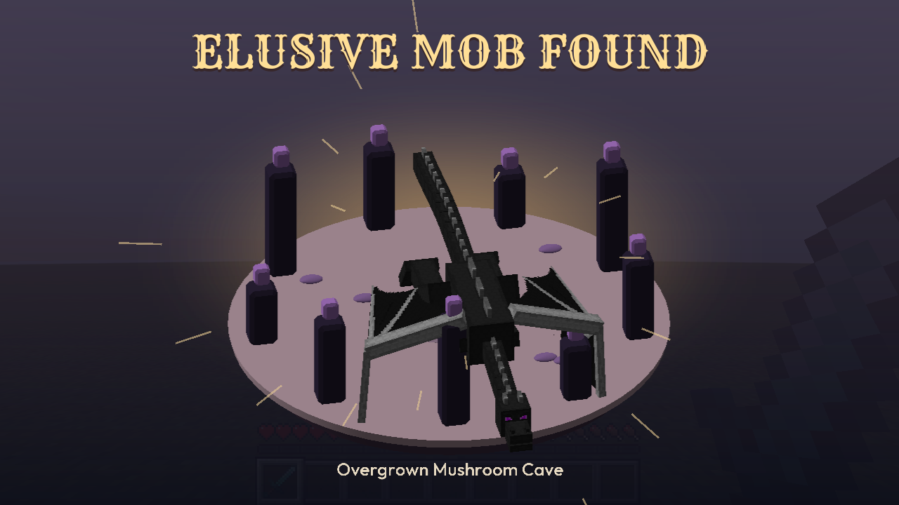
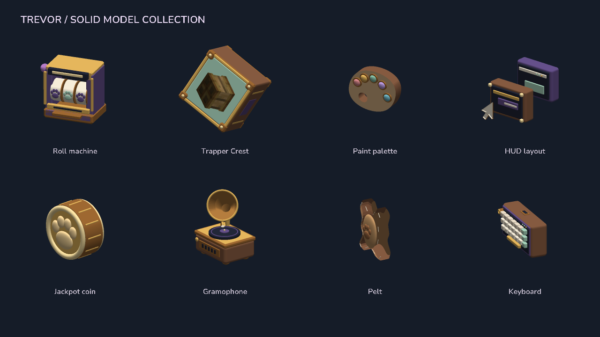
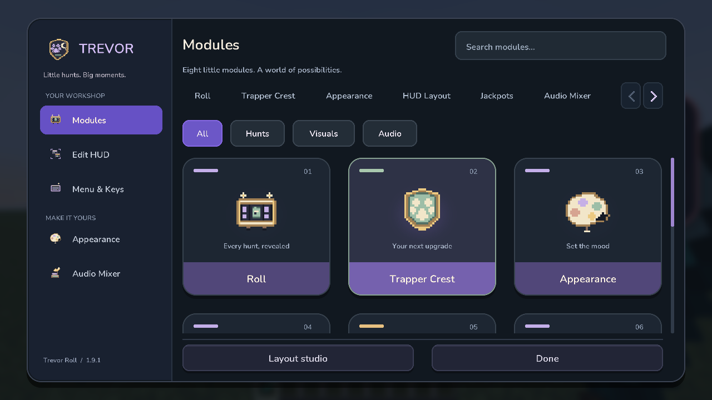

# Trevor Roll 1.9.1

**Extreme Elusive:** an animated Beth greeting leads into the dragon reveal, with the roar timed to the transition. Select **Jackpots → Extreme** and enable **Extreme 3D roll**. Elusive only.

| Extra | Extreme |
| --- | --- |
|  |  |

Extra keeps the illustrated gold coin. Extreme stays on the dragon through its fade. Minimal and Classic keep their lighter effects.

**Six rebuilt models** match the approved arcade machine and paint palette, whose geometry and colors stay unchanged. Advanced graphics is optional; static 2D remains the default.

The [visual feature guide](https://github.com/SleepCodeX/trevorRngMod#readme) covers rarity reveals, crest tracking, audio, HUD layout and menu controls with refreshed captures. The shortcut starts unbound.

**Install:** Minecraft 26.2, Java 25, Fabric Loader 0.19.5+ and Fabric API for 26.2. Replace your older Trevor Roll JAR with `trevor-roll-1.9.1.jar`. Open **`/trevormod settings`**.
