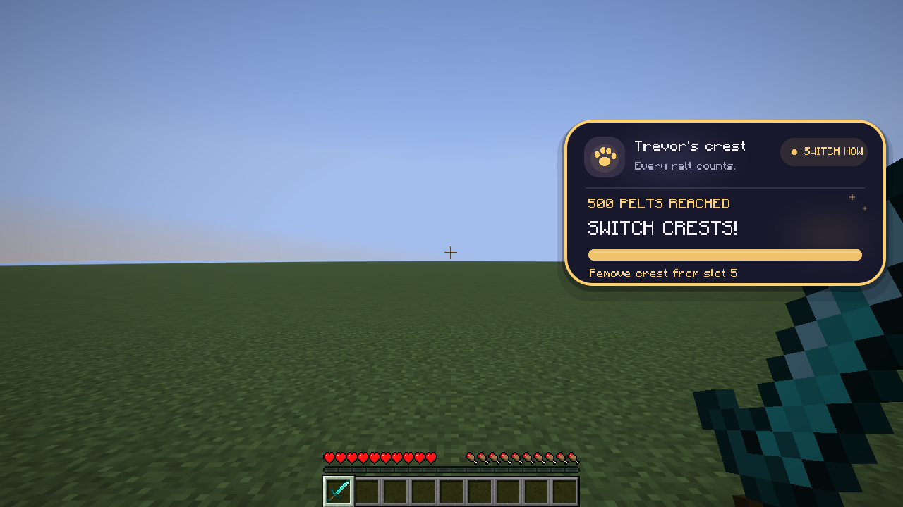
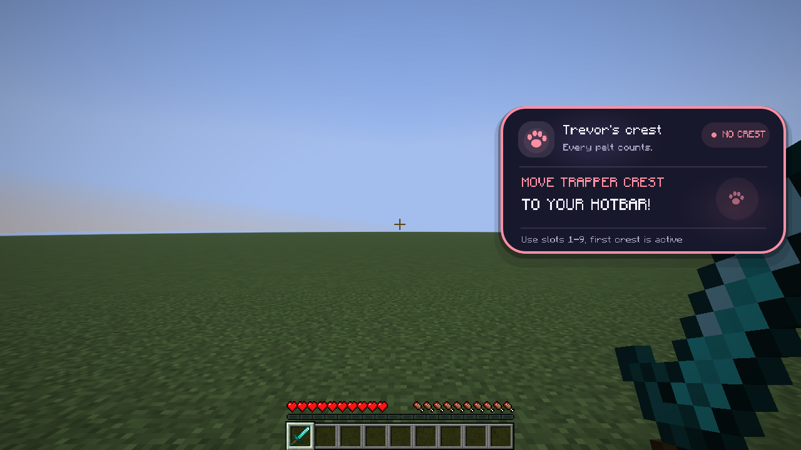
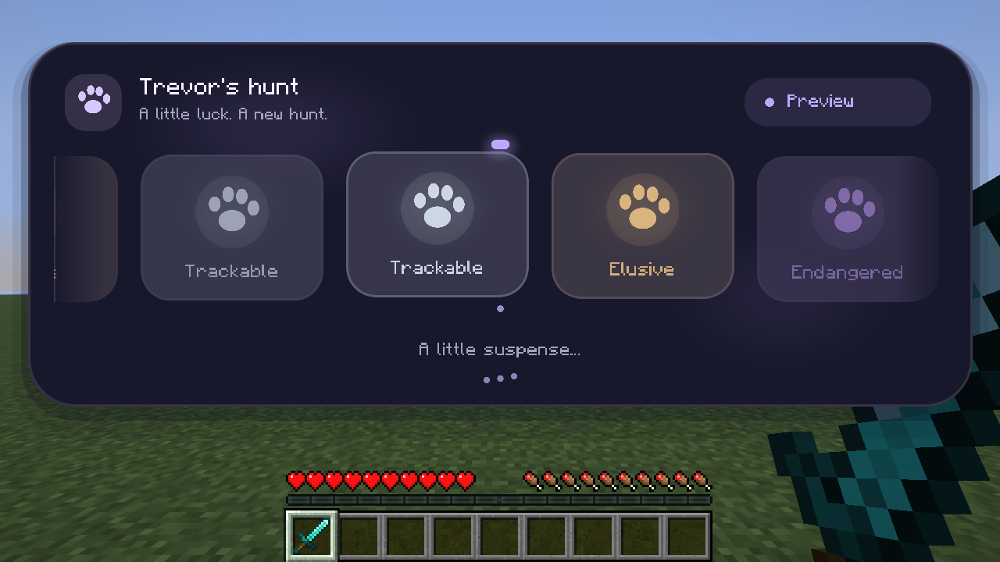

# Trevor Roll 1.7.0 validation

- Source: `a30d91e1ae2b1bbb751e38d89a724fa0c1a51c5f`.
- [Run 80](https://github.com/SleepCodeX/trevorRngMod/actions/runs/41233693141) passed Java 25 wrapper validation, real Loom `clean build check`, production JAR verification and `runProductionClientGameTest`.
- Client checks cover all eight modules at four window/GUI scale combinations, scrolling and keyboard focus, clipped input, native slider endpoints, search/categories, settings persistence, sound selection, key capture/native Controls/rebinding/reset/chat safety, and normal/depth artwork including edge-on views and OpenGL checks.
- Existing roll, crest, HUD, reward and audio checks also passed. Actual screenshots were visually inspected; [media provenance](docs/media/1.7.0/README.md) identifies the captures.
- Tests use a disposable offline singleplayer world. They do not authenticate to Hypixel or validate the user's full modpack.
- The final main workflow repeats build and client validation before publishing the tested JAR.

# Trevor Roll 1.4.0 validation

The user confirmed that the refined 1.4.0-dev build works well in-game on
2026-10-27 and requested stable promotion and the latest-release designation.
Version 1.4.0 changes only release metadata and documentation from that candidate.

- Tested candidate: `a1fb4c0998b0baa7b327cfb88a08121a687a8000`.
- Candidate build and real-client evidence: https://github.com/SleepCodeX/trevorRngMod/actions/runs/40535439519
- Stable builds and production-client checks: [Fabric 26.2 workflow](https://github.com/SleepCodeX/trevorRngMod/actions/workflows/build.yml).
- Stable installable JAR: [trevor-roll-1.4.0.jar](https://github.com/SleepCodeX/trevorRngMod/releases/download/1.4.0/trevor-roll-1.4.0.jar).
- Toolchain: Minecraft 26.2, Fabric Loader 0.19.5, Fabric API 0.161.0+26.2, Java 25 and real Fabric Loom 1.19.3.
- Required checks: `clean build check`, including production JAR bytecode verification, followed by `runProductionClientGameTest`.
- Candidate tests cover original roll/crest behavior, unified settings and legacy aliases, actual canvas dragging and corner resizing, locking, undo, disk persistence, and all four settings pages at two GUI scales. Screenshots were inspected.
- No compatibility stubs or hand-assembled runtime classes are used. Optional Mod Menu integration is compiled against the official 20.0.3 API; automated client tests run without Mod Menu installed.

## Historical 1.3.1 validation

# Trevor Roll 1.3.1 validation

Rebuilt and validated locally on Windows on 2026-10-27. This release uses the user's latest `trevor-roll-1.3.1-visual-performance-refined.zip` plus the subsequent hotbar-priority, bold-alert and MP requests. The user confirmed that the mod works in-game on 2026-10-27, approved the merge to main, and requested stable release 1.3.1. The stable JAR is rebuilt with version 1.3.1 in its metadata; runtime source is unchanged from the tested candidate.

## Toolchain and production artifact

- Minecraft 26.2, Fabric Loader 0.19.5, Fabric API 0.161.0+26.2.
- Eclipse Temurin JDK 25.0.5+8, Gradle wrapper 9.8.2, real Fabric Loom pinned to 1.19.3.
- Installable JAR: [dist/trevor-roll-1.3.1.jar](dist/trevor-roll-1.3.1.jar), with [SHA-256](dist/trevor-roll-1.3.1.jar.sha256).
- Every runtime class was compiled from source against official dependencies. No old compiled HUD classes, compatibility stubs, or manually assembled mod JAR were used.

Minecraft 26.2 is unobfuscated. The correct [`net.fabricmc.fabric-loom` plugin](https://docs.fabricmc.net/develop/loom/) provides the production `jar` task, included by `build`. The historical handoff's `remapJar` command was attempted and failed because that task does not exist for this plugin/target. Switching to remapping Loom would target the wrong Minecraft naming model. The file above is the actual installable Loom production JAR, not a renamed development or intermediary archive.

## Commands and results

```powershell
.\gradlew.bat clean build check runProductionClientGameTest --no-daemon
```

Result: **BUILD SUCCESSFUL**, 18 actionable tasks, 17 executed, 1 up-to-date.

- 91,012 original Trevor Roll parser/reel assertions passed.
- 68 crest lore, MP, slot-priority and state assertions passed.
- 313 visual/layout and animation assertions passed.
- `verifyProductionJar` passed against the actual installable JAR, checking both config classes with `javap -p -v`.
- Java class-file major version is 69 (Java 25).
- Both `FabricLoader.getInstance` and `FabricLoader.getConfigDir` use `InterfaceMethodref`, with `invokestatic` and `invokeinterface` respectively. No ordinary `Methodref` targets FabricLoader.
- No `net/fabricmc/**` or `net/minecraft/**` runtime/stub classes or game-test harness classes are bundled.

Evidence: [build and client log](docs/validation/build-and-client.log), [crest config bytecode](docs/validation/CrestHudConfig-bytecode.txt), [original roll config bytecode](docs/validation/RollConfig-bytecode.txt).

## Real Minecraft startup and integration tests

Loom's production client task launched the packaged JAR with Minecraft 26.2, Loader 0.19.5, Fabric API and a separate test-harness mod. It reached the title screen, created and entered a disposable singleplayer world, rendered the HUD and original reel, then shut down successfully. The harness is not part of the installable JAR.

The actual client checks cover:

- Real `ItemStack` and `ItemLore` components in every slot 1-9; non-crest items are ignored.
- The leftmost crest wins, even with a later Rare crest. Removing it immediately selects the next crest.
- Unchanged components reuse parsed state; changing lore invalidates the cache. Scanning occurs on client ticks, outside rendering.
- 500-pelt completion before the rarity label updates, plus Common/Uncommon/Rare/missing transitions and 3/5/8 MP-only lore. A live tick-driven check also verifies switching to the next crest and showing the missing-hotbar action without invoking the scanner or demo commands.
- All `/trevorcrest` demos, toggle, scale, top, right, reset and persisted config.
- All five `/trevorroll test` rarities, toggle, sound, duration, skip, and the completed Elusive announcement.
- Screenshots at GUI scales 1, 2 and 3 at 854x480 and 1280x720. Alert text fits and the crest card yields while the original reel is active.

The offline test account emits expected Realms/profile-key HTTP 401 messages. It does not authenticate to Hypixel; these messages did not prevent client startup or any test.

## Screenshots from the running game

Gold completion alert, including the active slot:



Bold missing-hotbar reminder:



Original Elusive reel, with the crest card yielding space:



## Preservation and remaining validation

Original hunt detection, commands, sound behavior, reel timing, rendering code and textures are preserved. `TrevorRollClient` only gains a read-only active-reel query so the crest HUD can yield space; its existing animation and command implementations are unchanged.

The local `.minecraft/mods` folder contains 26.1.x mods and Fabric API 0.155.2+26.1.2. That is not a compatible full-modpack test for 26.2, so those files were not modified or used. The user subsequently confirmed that the mod works in-game and requested this stable release. MP-only detection is tested with representative item lore; whether another mod's MP display is exposed in server item lore must be confirmed in that modpack.

GitHub Actions repeats the full build, bytecode verification and production-client tests. Its release artifact contains only the installable mod JAR; logs, bytecode and all screenshots are uploaded separately as validation evidence. No merge or release is authorized by a passing automated run alone.
